# Diplomacy Online, Design Document

**Team**: The Diplomats (CSCI 3308, team 011-6)<br>
**Members**: Nathaniel Blucher, Deven Chen, Brynne Geittmann, Rez Haleem, Justin Kurtz<br>
**Repo**: https://github.com/The-Diplomats/Diplomacy<br>
**Status**: Draft v1, awaiting team review before implementation begins

---

## 1. Overview

Diplomacy Online is a web-based implementation of the 1950s strategy board game Diplomacy. Players compete across a map of pre-WWI Europe to capture supply centers through negotiation, strategic maneuvering, and betrayal. The application supports 2-7 players per game, in-game chat (both public and private), deadline-based asynchronous play, and AI opponents powered by a locally-hosted LLM.

Target delivery: **4-week sprint** culminating in a working demo at the end of the semester.

---

## 2. Why This Architecture (vs the Current Scaffolding)

The repo currently has a Lab-style scaffold: single Node/Express app, Handlebars views, raw SQL in `src/init_data/`, everything in one process. That worked for Lab 7's hiking CRUD. It breaks under what our proposal commits to. This section shows **why**, using before/after visuals for the key decisions.

### 2.1 Why split backend and worker?

**Before (one Node process, lab scaffold):**

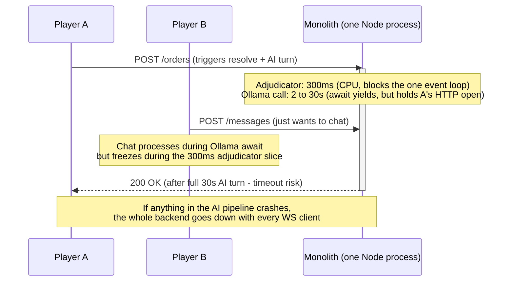

Node has one main thread running one event loop. "Non-blocking I/O" means `await db.query()` and `await ollama.generate()` yield the loop — other handlers *can* run during the wait. So Ollama alone doesn't freeze chat. But three real problems remain in a monolith:

1. **The adjudicator (~300ms) is pure CPU.** No `await` to yield on. The one event loop is genuinely frozen during that slice; every other handler stalls.
2. **The player's HTTP request can't wait 30 seconds.** Even if the loop stays free, browsers time out around 30-60s on fetch, and "button spinning for half a minute" is bad UX regardless. The response has to come back fast.
3. **A single crash takes everyone down.** If the Ollama call throws, if the parser hits malformed JSON, if memory spikes — the whole backend process dies and every connected WebSocket client drops.

**After (backend + worker split):**

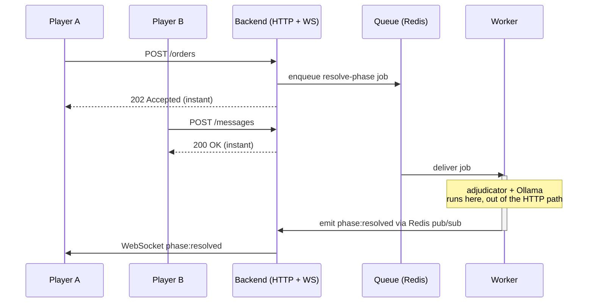

Backend returns 202 instantly. The 300ms CPU block and the long Ollama call both move to the worker, out of any HTTP response path. A worker crash is contained — BullMQ retries the job and the backend keeps every WS connection alive. Separate processes also mean independent scaling (worker on queue depth via KEDA; backend on HTTP connection count) and separate memory accounting.

### 2.2 Why TypeScript instead of plain JavaScript (like the labs)?

**Before (plain JS, lab pattern):**

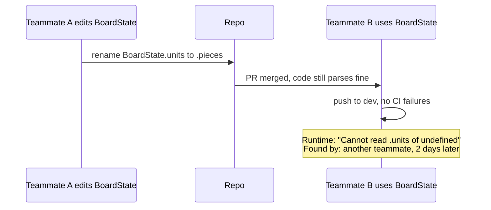

A shared-type change in a monorepo without compile-time types ripples silently to every consumer. The failure happens at runtime, usually in a different workstream than the one that caused it, often days later.

**After (TypeScript):**

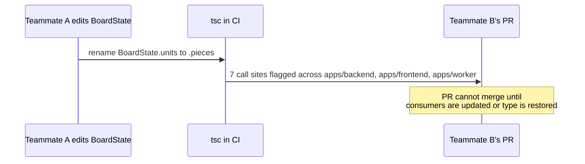

The compiler surfaces every consumer in CI before the PR merges. For 5 people simultaneously changing shared packages (`contracts`, `adjudicator`, `game-types`), this is the difference between "it works on my machine" and "it worked when the whole team pushed it."

**Three concrete payoffs beyond the renamed-field example:**

1. **OpenAPI codegen (next section) only pays off with TS.** Kubb generates typed React Query hooks like `useSubmitOrders({ orders: Order[] })`. In plain JS, you'd still call the hook, but the editor can't autocomplete the payload shape and the compiler can't catch typos. The whole contract-first architecture degrades to "generated code is decoration."

2. **The adjudicator is intricate-typed logic.** `BoardState`, `Order`, `Resolution`, `SupportChain`, `DislodgedUnit`, `ConvoyRoute`, each with multiple variants. The TS compiler catches "I passed a build order to the retreat resolver" before DATC tests even run.

3. **Refactor safety for 5 people on shared packages.** Rename a field in `packages/game-types` and the TypeScript compiler shows every file that breaks across all three apps + three packages. In JS, you grep carefully and hope.

**Cost:** one `tsc --watch` process in dev, slightly slower iteration on exploratory code (occasional "the compiler is yelling at me"), one additional ramp-up topic for teammates less familiar with TypeScript. Standard tradeoff for a monorepo at team scale.

### 2.3 Why OpenAPI contract instead of just defining routes?

**Before (sequential, no shared contract):**

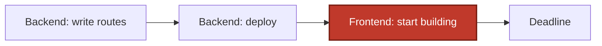

Frontend blocked waiting for backend. Serial work across the whole team.

**After (contract first, parallel work):**

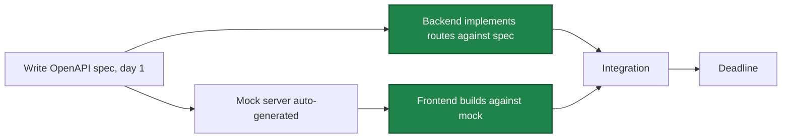

Backend and frontend work in parallel from day 1. Runtime validator at the API boundary catches any drift between code and spec. Teammates on frontend don't block on teammates on backend.

### 2.4 Why 3 cloud envs instead of 1?

**Before (one env):**

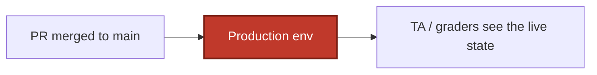

Every PR merge is one bad diff away from breaking the demo URL.

**After (dev auto, stage auto, prod gated):**

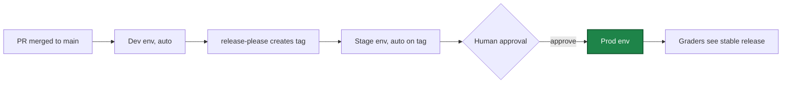

Bad merges land in dev. Stage proves the release pipeline works. Prod only moves after a human approves.

### 2.5 Why monorepo + shared packages?

**Before (one `src/`, 5 people):**

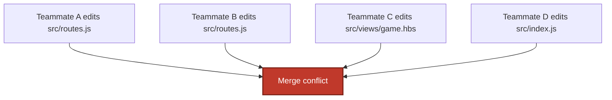

5 people fighting the same files. Constant merge pain.

**After (monorepo with per-stream ownership):**

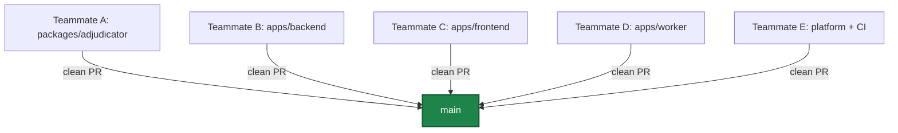

Each teammate owns a workstream. Shared pieces (contracts, adjudicator, game-types) live in `packages/` where a type change ripples with TypeScript compiler safety to every consumer. In the lab scaffold's single `src/`, the same ripple is "hope you grepped carefully."

### 2.6 Why Redis AND Postgres (not just Postgres)?

Two separate things both want Redis, so we add one Redis and let both use it:

1. **BullMQ job queue**, persists delayed jobs through restarts. `setTimeout` for a 24h deadline dies on the next deploy; Redis-backed jobs don't.
2. **Socket.IO pub/sub adapter**, lets the worker emit WebSocket events to clients connected to any backend replica.

Both roles are purpose-built for Redis. Postgres can technically do either, poorly.

### 2.7 What we kept vs changed

**Kept from the lab stack:**
- Node + Express + pg-promise + PostgreSQL (the backbone)
- bcryptjs + express-session (lab auth pattern)
- Mocha + Chai (lab testing)
- Docker Compose for local dev
- Raw SQL for schema (just incremental via node-pg-migrate)

**Added for what the proposal commits to:**
- React SPA + Vite (interactive board + chat; Handlebars can't do that)
- Socket.IO + Redis adapter (real-time chat + board updates)
- BullMQ + worker process (24h deadlines + AI turns in the background)
- OpenAPI contract (parallel frontend/backend work across 5 teammates)
- Monorepo + shared packages (team scaling + type safety across apps)
- 3 cloud envs with approval gate (demo-day safety)
- Microsoft OAuth (university-friendly login)

**Deliberately NOT adopted:**
- Kubernetes / Helm / Pulumi (overkill for 3 containers)
- Microservices (we have 3 processes, not 30)
- Module federation, service mesh, distributed tracing (100-engineer-org stuff)

### 2.8 TL;DR

Every architectural piece exists to satisfy a specific thing the proposal committed us to:

- Skip the backend/worker split, chat freezes during AI turns.
- Skip the OpenAPI contract, frontend sits idle waiting for backend.
- Skip the 3-env pipeline, one bad merge breaks the demo URL.
- Skip the monorepo, 5 people merge-conflict their way through 4 weeks.
- Skip Redis, deadlines evaporate on every deploy.
- Skip TypeScript, shared-package changes break at runtime days later.

Starting with the right shape costs ~2 days of solo scaffolding at the start of M1 and saves the whole team from retrofitting these pieces one at a time under deadline pressure.

---

## 3. Goals & Non-Goals

### Goals (MVP)

- 7-player classic Diplomacy map with full orders (Hold / Move / Support / Convoy / Retreat / Build)
- In-game chat: public channel + private 1:1 DMs (white press)
- Ready-check turn advancement with grace period + 24h deadline fallback
- AI opponent via Ollama with persistent memory, alliances, and betrayals
- Civil Disorder handling for AFK players (per-phase defaults; per-player lockout after 3 consecutive missed phases)
- 3-env deployment pipeline (dev / stage / prod)
- Microsoft OAuth login (plus password auth)

### Non-Goals (deliberately deferred)

- Group chats (3+ player channels)
- Spectator mode
- Mid-game replacement players
- Non-DIAS draw voting (specific-subset draws)
- Multi-variant map support (chaos, modern, etc.)

---

## 4. Use Cases

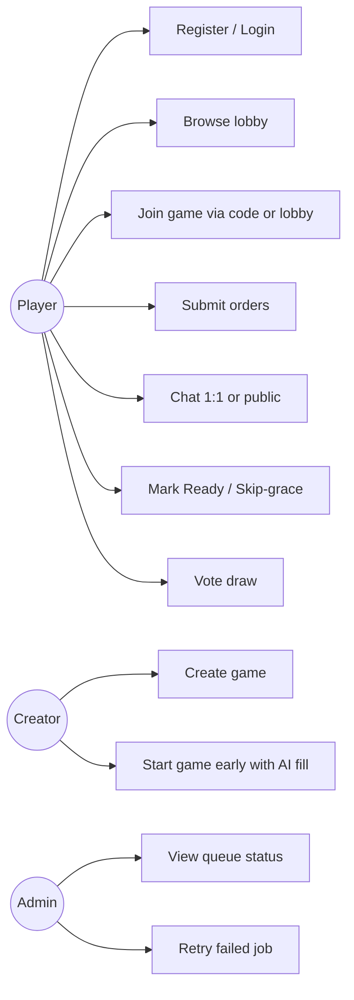

---

## 5. System Architecture

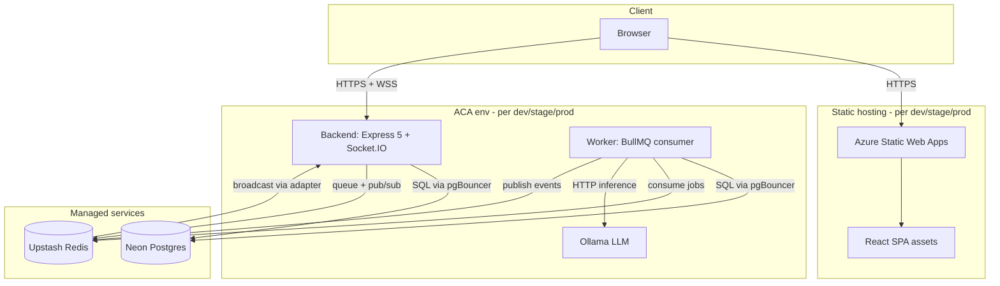

Each of the three environments (dev, stage, prod) is a fully isolated instance of the above. No shared infrastructure between envs.

---

## 6. Component Breakdown

### Repo layout (two levels)

GitHub Actions only scans `.github/workflows/` at the git repo root, so `.github/` lives at the top, outside the monorepo. The monorepo itself (pnpm workspace root) is `ProjectSourceCode/`.

```
Diplomacy/                              # git repo root
├── .github/
│   ├── labeler.yml                     # path-to-label rules for actions/labeler
│   ├── pull_request_template.md
│   └── workflows/                      # flat per-concern CI
├── MilestoneSubmissions/               # design doc, meeting minutes, submissions
├── TeamMeetingLogs/
└── ProjectSourceCode/                  # monorepo (pnpm workspace root)
    ├── apps/
    │   ├── backend/                    # Express 5 + Socket.IO HTTP/WS server
    │   ├── frontend/                   # Vite + React SPA
    │   └── worker/                     # BullMQ consumer for jobs
    ├── packages/
    │   ├── contracts/                  # OpenAPI spec + generated types + Socket.IO event types
    │   ├── adjudicator/                # pure-function Diplomacy rules engine (TS)
    │   ├── game-types/                 # pure TS domain types (BoardState, Order, Power) + classic-map.json
    │   └── db/
    │       ├── src/
    │       │   ├── schema.ts           # Drizzle table definitions - single source of truth
    │       │   ├── client.ts           # configured Drizzle client (reads DATABASE_URL)
    │       │   └── index.ts            # re-exports schema + client
    │       ├── migrations/             # drizzle-kit generated .sql + meta/
    │       ├── seed/                   # hand-written seed data (dev-only mostly)
    │       └── drizzle.config.ts       # drizzle-kit config
    ├── platform/
    │   └── docker/                     # shared Dockerfile bases
    ├── pnpm-workspace.yaml
    ├── package.json
    └── docker-compose.yaml
```

### Responsibility matrix

| Component | Responsibility | Depends on |
|---|---|---|
| `apps/backend` | HTTP API + WebSocket server; auth; OpenAPI validation at request/response | `packages/contracts`, `packages/game-types`, `packages/adjudicator` (validation), `packages/db` |
| `apps/worker` | BullMQ job consumer: resolve phases, process AI turns | `packages/contracts`, `packages/game-types`, `packages/adjudicator`, `packages/db` |
| `apps/frontend` | React SPA; interactive SVG board; chat UI; deployed as static artifact to Azure Static Web Apps per env | `packages/contracts` (generated client), `packages/game-types` |
| `packages/contracts` | OpenAPI spec + bundled artifacts + Kubb client + MSW handlers + Socket.IO event types | none |
| `packages/adjudicator` | Pure functions: `resolve()`, `getLegalMoves()`; DATC test suite | `packages/game-types` |
| `packages/game-types` | Pure TS domain types (`BoardState`, `Order`, `Power`, `Province`); static `classic-map.json`. Zero DB knowledge. | none |
| `packages/db` | Drizzle schema (`schema.ts`) — single source of truth for DB tables; generated migrations; seed data; configured Drizzle client exported for backend + worker; typed row types inferred from schema (`typeof games.$inferSelect`) | `packages/game-types` (for domain-type references in some columns) |

---

## 7. Data Model

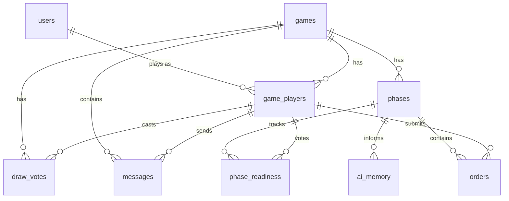

### Table purposes

| Table | Purpose | Notes |
|---|---|---|
| `users` | Base identity, auth credentials | `password_hash` nullable (OAuth users); `(oauth_provider, oauth_subject)` UNIQUE when non-null. For Microsoft: `oauth_subject = "{tid}:{oid}"` (NOT the OIDC `sub`, which is pairwise-per-app and documented as non-portable). Future-provider conventions TBD. |
| `games` | Game instances with lifecycle metadata | `status` ∈ `forming / active / finished / abandoned`. `movement_deadline_seconds INT NOT NULL DEFAULT 86400`; retreat and build deadlines computed as `movement_deadline_seconds / 2`. |
| `game_players` | Many-to-many between users and games; captures role (power), AI status, AFK counter | `user_id` NULL for AI slots; `power` randomly assigned at start. `afk_counter INT NOT NULL DEFAULT 0` increments on phase resolve if the human submitted no orders and wasn't ready, resets to 0 on any order submission. `locked BOOLEAN NOT NULL DEFAULT false` (one-way) when `afk_counter` hits 3; locked powers have defaults auto-applied for the remaining game. |
| `phases` | Game clock: one row per phase, with board snapshot JSON | `phase_type` ∈ `movement / retreat / build`. `deadline_at TIMESTAMPTZ NOT NULL` captures the phase's absolute deadline (used by the un-ready-during-grace path to re-arm the original deadline rather than resetting it). |
| `orders` | Per-unit orders per phase; adjudicator fills `result` post-resolution | Many per phase |
| `phase_readiness` | Per-player per-phase ready + skip-grace votes | Row absent = not ready; reset each phase |
| `draw_votes` | DIAS draw vote tracking per player per game | All survivors with row = draw |
| `ai_memory` | AI's persistent strategic notes (alliances, promises, grudges) | Isolated per `(game_id, power)`. Server-side only; never served via any API — see §15 AI memory privacy. |
| `messages` | Chat (public or private 1:1) | `to_player_id` NULL = public |
| `session` | Managed by `connect-pg-simple`; cookie-based sessions | We don't write SQL against it |

Schema defined in TypeScript at `packages/db/src/schema.ts` (Drizzle ORM) — single source of truth. Migrations auto-generated by `drizzle-kit generate` from schema diffs (dev runs locally, commits both the schema change and the resulting SQL file to `packages/db/migrations/`, reviewer approves both in the PR). Migrations run from a dedicated GH Actions step before each ACA deploy (`pnpm --filter @diplomacy/db migrate`), against Neon's direct (non-pooled) connection URL. pgBouncer transaction-mode would break the advisory locks and transactional DDL that migrations rely on. The migrate step also creates a Neon branch `pre-migration-{commit-sha-short}` before applying, and on failure the pipeline promotes that branch back to primary (see §15 Data loss / corruption). Backend and worker both import `{ db, games, phases, ... }` from `@diplomacy/db` and query via Drizzle's typed builder (`db.select().from(games).where(eq(games.id, id))`); the TS compiler catches schema/query drift at build time across the whole monorepo.

---

## 8. API Design

OpenAPI 3.1 contract-first. Spec lives at `packages/contracts/api/public/openapi.yaml`. All endpoints validated at runtime (request + response) by `express-openapi-validator`. The validator is mounted on `/api` only; the Socket.IO handshake path `/socket.io/` and health endpoints are intentionally outside its scope. Spec paths are mount-relative (e.g., `/games/:id` in the spec → `/api/games/:id` on the wire). The Kubb-generated client sets its baseURL to `/api` to match.

### Endpoint summary

| Group | Method | Path | Purpose |
|---|---|---|---|
| Auth | POST | `/auth/register` | Password registration |
| Auth | POST | `/auth/login` | Password login |
| Auth | POST | `/auth/logout` | Clear session |
| Auth | GET | `/auth/me` | Current user |
| Auth (OAuth) | POST | `/auth/oauth/microsoft/login` | Returns OIDC auth URL |
| Auth (OAuth) | GET | `/auth/oauth/microsoft/callback` | Code exchange + session start |
| Games | GET | `/games` | List games (lobby) |
| Games | POST | `/games` | Create game |
| Games | GET | `/games/:id` | Get game detail |
| Games | POST | `/games/:id/join` | Join (by code or open slot) |
| Games | POST | `/games/:id/start` | Creator starts early with AI fill |
| Games | POST | `/games/:id/draw-vote` | Toggle draw vote |
| Games | DELETE | `/games/:id/draw-vote` | Remove draw vote |
| Phases | GET | `/games/:id/phases/current` | Current phase state |
| Phases | POST | `/games/:id/phases/current/resolve-now` | Dev-only manual resolve |
| Orders | GET | `/games/:id/phases/current/orders` | List own orders |
| Orders | PUT | `/games/:id/phases/current/orders` | Submit/update orders |
| Ready | POST | `/games/:id/phases/current/ready` | Mark ready |
| Ready | DELETE | `/games/:id/phases/current/ready` | Un-ready |
| Ready | POST | `/games/:id/phases/current/skip-grace` | Vote skip-grace |
| Messages | GET | `/games/:id/messages` | List messages |
| Messages | POST | `/games/:id/messages` | Send message |

**OAuth transient state:** `state`, `nonce`, and the PKCE `code_verifier` persist on `req.session` between `/login` and `/callback` (openid-client canonical idiom). `connect-pg-simple` writes a pre-auth session row; `pruneSessionInterval` cleans the orphans.

### Socket.IO events

Not covered by OpenAPI. Typed via hand-written TS in `packages/contracts/sockets/events.ts`:

- `phase:resolved`, payload includes new board state + resolution results
- `ready:changed`, N/M counter update
- `skip-grace:changed`, N/M counter update
- `message:new`, new chat message
- `cd:changed`, civil disorder status change; payload includes `player_id`, current `afk_counter`, and `locked` flag
- `game:ended`, game concluded (with reason)

---

## 9. Game Lifecycle State Machine

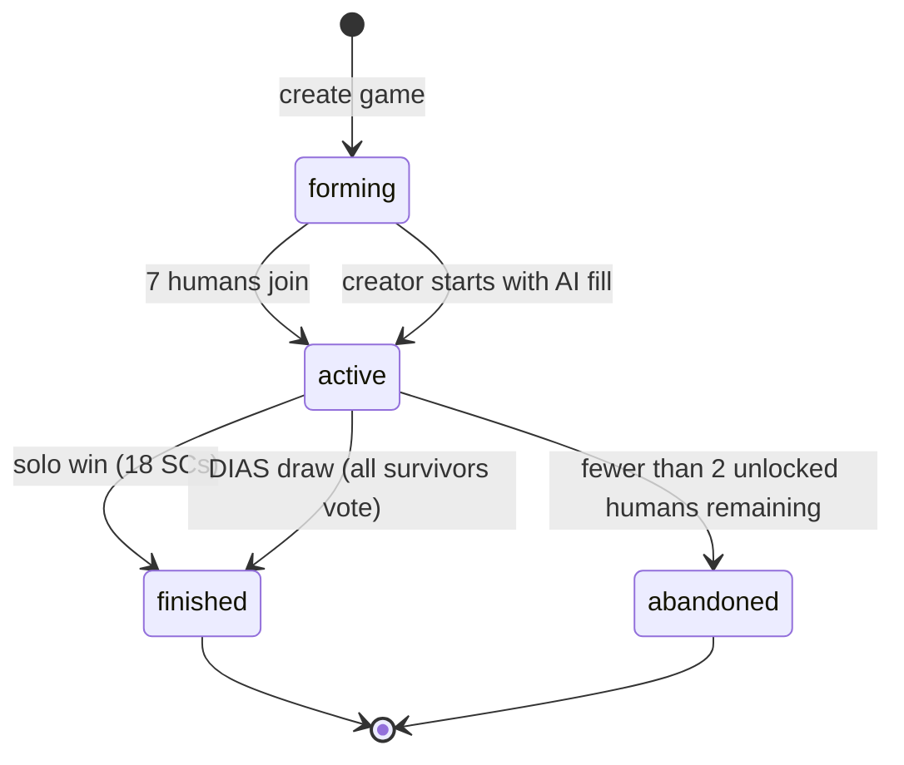

**Status transitions written by:**
- `forming → active`: `/games/:id/start` endpoint or auto-trigger when 7th human joins
- `active → finished`: worker after Winter/Build phase (solo detection) or on draw-vote update
- `active → abandoned`: worker after resolving a phase in which the last human player's `afk_counter` hit 3 and was flipped to `locked = true`. Condition: `COUNT(*) FROM game_players WHERE game_id = $1 AND user_id IS NOT NULL AND locked = false < 2`. A single dropped human never kills the game — teammates can play on with AI opponents; only when fewer than 2 humans remain unlocked does the game clean itself up.

---

## 10. Phase Resolution Flow

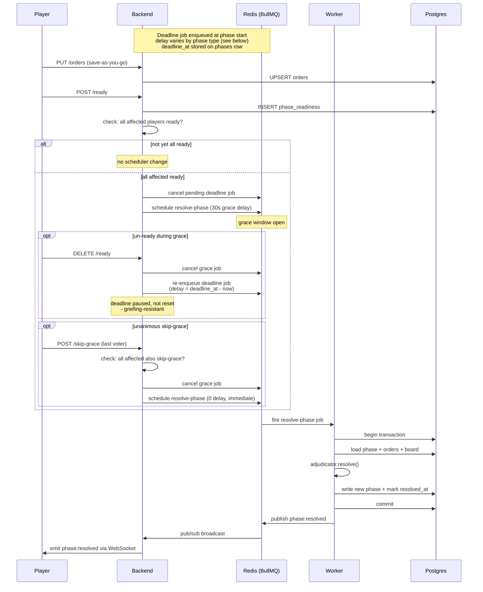

**Idempotency guard (correctness, not optimization):**

BullMQ guarantees "at least once" delivery, a job can run more than once if a worker loses its lock or crashes mid-processing, and `queue.remove()` cannot cancel a job that is already in the `active` state. The handler therefore cannot assume one-shot execution. On entry it runs:

```sql
BEGIN;
SELECT 1 FROM phases WHERE id = $1 AND resolved_at IS NULL FOR UPDATE;
```

If the row is missing or already resolved, the handler commits and returns a no-op. Otherwise it computes the new state and writes `resolved_at = NOW()` in the same transaction. Two concurrent workers racing on the same phase serialize at the row lock, and only the winner writes. The `queue.remove()` calls in the flow above are best-effort optimizations to avoid redundant worker wakeups, they are not the correctness mechanism.

**Deadline computation (per phase type):**

- **Movement** phases: delay = `games.movement_deadline_seconds` (default 86400).
- **Retreat** phases: delay = `movement_deadline_seconds / 2`.
- **Build** phases: delay = `movement_deadline_seconds / 2`.

The backend persists the absolute `deadline_at` on the `phases` row so the un-ready-during-grace branch (above) can re-arm the original deadline instead of resetting it.

**Resolution triggers (in priority order):**

1. **Unanimous skip-grace** → immediate
2. **All affected ready + 30s grace elapsed** → scheduled
3. **Deadline reached** → fallback. Backend applies per-phase-type defaults *before* invoking the adjudicator so the adjudicator always sees a complete order set:
   - **Movement**: missing orders → Hold
   - **Retreat**: missing retreats → Disband (dislodged unit disbanded)
   - **Build**: missing builds → auto-disband farthest-from-home (Avalon Hill convention)

**Auto-skip empty phases:**

When a prior phase resolves and the backend chooses the next phase to create:

- Next-is-Retreat → check if any power has a dislodged unit. If none → **skip entirely** (no phase row created, no deadline job, advance directly to the next Movement).
- Next-is-Build → check if any power has an SC-count/unit-count delta. If none → **skip entirely**, advance.

Only decision-bearing phases exist in Postgres. Players never see a 24h-stale UI for a phase with no decisions.

**"Affected players" per phase type:**

- Movement: all surviving powers (every power with ≥1 unit)
- Retreat: only powers with dislodged units
- Build: only powers with a build/disband delta

The all-affected-ready check in the sequence above is per-phase-type by this definition. AI powers are always treated as instantly ready for grace purposes (they submit orders programmatically and set phase_readiness Ready + Skip-grace in the same transaction).

---

## 11. AI Turn Flow

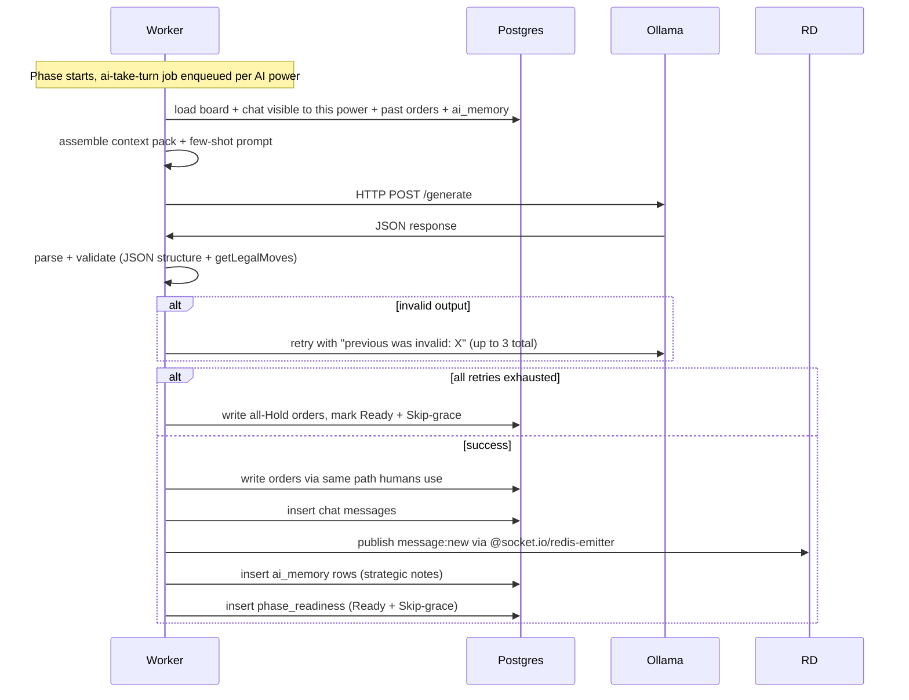

**Why stateless workers + stateful DB**: the AI's "memory" lives entirely in Postgres (chat log, past orders, `ai_memory`). No in-memory agent, no per-game process. Scales trivially via BullMQ worker replicas.

**Broadcast path for AI-authored chat**: the worker uses `@socket.io/redis-emitter` to publish `message:new` after inserting chat rows. The backend's `@socket.io/redis-adapter` fans the event out to all connected WS clients. This is the same cross-process pattern §10 uses for `phase:resolved`, just applied to chat too, so live clients see AI chat without having to refetch.

**Idempotency guard (same shape as §10):**

Jobs are enqueued with deterministic `jobId = ai-take-turn:${gameId}:${power}:${phaseId}`. BullMQ dedupes while the job exists in Redis, and its atomic Lua lock on `active` ensures only one worker replica picks any given job. On entry the handler runs:

```sql
BEGIN;
SELECT 1 FROM phases WHERE id = $1 AND resolved_at IS NULL FOR UPDATE;
SELECT 1 FROM orders WHERE phase_id = $1 AND power = $2 FOR UPDATE;
```

If the phase is already resolved, or orders already exist for `(phase_id, power)`, the handler commits and returns a no-op. Otherwise it proceeds. This handles the stalled-job replay case (worker crashes mid-handler, BullMQ promotes to stalled, another worker runs it) without duplicating orders or memory writes.

---

## 12. Realtime Communication

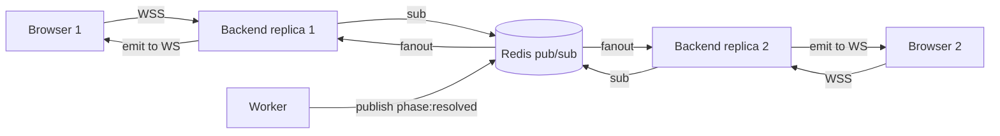

**Socket.IO rooms:**
- `game:<id>`, all players in a game (public events + public chat)
- `game:<id>:player:<player_id>`, single player (private DMs addressed to them)

**Auth**: HTTP session cookie flows into the WS handshake via `io.engine.use(sessionMiddleware)`. One auth system end-to-end. The frontend and backend run on **subdomains of a single apex domain** (`app.<apex>` and `api.<apex>`), so the session cookie is set on `.<apex>` with `SameSite=Lax` instead of the permissive `SameSite=None`. Browser enforces same-site semantics at the request layer, which blocks the vast majority of CSRF and CSWSH attempts before they ever reach the backend. As defense-in-depth, Socket.IO is still configured with an explicit `allowRequest` handler that validates the `Origin` header against the known frontend origins per env, rejecting unknown origins with HTTP 403 before the upgrade completes. The same allowlist is used by the REST CORS config so there is one source of truth.

**Transport**: WebSocket only (no polling fallback). Avoids sticky load balancing requirements.

**Reconnect state recovery**: Socket.IO's auto-reconnect only re-establishes the connection; it does not replay events that fired during the dead window. On successful reconnect, the client calls `queryClient.invalidateQueries(['game', id])` which triggers a TanStack Query refetch of the current phase + board + messages via REST. This brings the client back to the authoritative server state before any new WS events arrive. The server does not maintain a per-client event log, so there is no replay channel to subscribe to, the authoritative state is always Postgres, surfaced via GET.

**Reconnection**: client retries 10 times with exponential backoff; surfaces a sonner toast on exhaustion.

**Cross-process event emission**: the worker is a separate Node process from the Socket.IO server. It emits events using `@socket.io/redis-emitter` (official emit-only client — no HTTP server, no engine state). The emitter speaks the same Redis wire protocol as `@socket.io/redis-adapter`, which the backend's real `Server` is attached to; events published from the worker arrive at every connected client as if the backend emitted them itself. All worker-sourced events use this path: `phase:resolved`, `message:new` for AI chat, `cd:changed`, `game:ended`. The emitter and adapter packages must share a major version — mismatched versions cause events to vanish into Redis with no subscriber.

**Local development**: Vite dev server (localhost:5173) proxies `/api/*` and `/socket.io/*` (with `ws: true`) to Express (localhost:3000) via Vite's `server.proxy` config. `changeOrigin: true`, and the `Origin` header is stripped on `/api` to make dev look same-origin as prod (CP-6053 pattern from control-plane-frontend). The browser sees everything as same-origin, so `SameSite=Lax` and session cookies work identically in dev and prod with no CORS config on the backend. Teammates can override `PROXY_API_TARGET` env var to point the frontend at a deployed dev backend without running the full stack locally.

---

## 13. CI/CD Pipeline

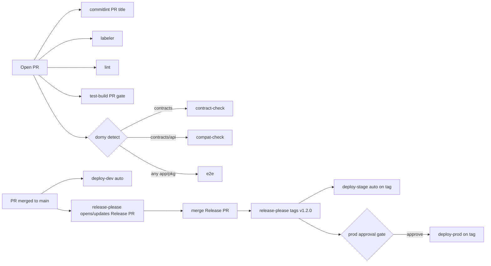

**Workflow trigger table:**

| Workflow | Trigger | Purpose |
|---|---|---|
| `commitlint.yml` | PR open/sync | Lints PR title against conventional-commit format. Required check. |
| `labeler.yml` | PR open/sync | Auto-adds `area:*` labels based on changed paths. |
| `lint.yml` | PR open/sync | ESLint + Prettier + typecheck. Always runs. |
| `test-build.yml` | PR open/sync | Full build + unit tests + E2E against Compose stack. Uses `environment: dev` for secret scope but does NOT deploy. Acts as the deployability check. |
| `contract-check.yml` | PR open/sync (if `packages/contracts/**` changed) | Regen contracts, assert no diff. |
| `compat-check.yml` | PR open/sync (if `packages/contracts/api/**` changed) | oasdiff vs base branch. Fails on breaking changes without `breaking-change-approved` label. |
| `e2e.yml` | PR open/sync (if any `apps/**` or `packages/**` changed) | Playwright E2E + Postman contract tests against a Compose stack with `MOCK_AI=true` (MSW intercepts the Ollama HTTP endpoint; fixtures at `apps/worker/test/fixtures/ollama/*.json`). Covers prompt assembly, parse, legal-move validation, retry loop, fallback-to-all-Hold. |
| `ai-smoke.yml` | `workflow_dispatch` only | Runs real Ollama against a Compose stack. Exercises 2-3 AI turns in a real game, asserts legal orders submitted (not quality — matches §18 acceptance threshold). WS-5 runs before significant AI changes land. Not a PR gate. |
| `migrate.yml` | reusable (`workflow_call`) | Creates a Neon branch `pre-migration-{commit-sha-short}`, runs `node-pg-migrate up` against Neon's direct (non-pooled) connection. On failure, promotes the branch back to primary. Called by `deploy-dev.yml` / `deploy-stage.yml` / `deploy-prod.yml` before their ACA deploy step. |
| `deploy-dev.yml` | `push: branches: [main]` | Calls `migrate.yml` then auto-deploys backend + worker to dev ACA env on PR merge. |
| `deploy-frontend-dev.yml` | `push: branches: [main]` | Builds and uploads the SPA static artifact to the dev Azure Static Web App on PR merge. |
| `release-please.yml` | `push: branches: [main]` | Updates the Release PR with CHANGELOG + version bump based on conventional-commit types since last release. |
| `deploy-stage.yml` | `push: tags: ['v*']` | Calls `migrate.yml` then auto-deploys to stage ACA env when release-please creates a tag. |
| `deploy-frontend-stage.yml` | `push: tags: ['v*']` | Uploads the SPA static artifact to the stage Azure Static Web App on tag. |
| `deploy-prod.yml` | `push: tags: ['v*']` | Calls `migrate.yml` then deploys to prod ACA env. Requires reviewer approval via `prod` GH environment config. Same tag drives both stage and prod. |
| `deploy-frontend-prod.yml` | `push: tags: ['v*']` | Uploads the SPA static artifact to the prod Azure Static Web App. Same `prod` GH environment approval gate as `deploy-prod.yml`. |
| `discord-pr.yml` | PR open | Existing Discord notification. |

**Change detection via dorny/paths-filter**: conditional workflows still trigger on every PR (keeps branch protection happy) but gate their jobs with `if: needs.detect.outputs.X == 'true'`. A no-op workflow still reports success.

**Dependency propagation**: changing `packages/contracts/**` triggers backend AND frontend AND worker tests. Changing `packages/game-types/**` or `packages/adjudicator/**` triggers all consumers.

**release-please + conventional commits:**
- Commit messages and PR titles follow conventional format (`feat:`, `fix:`, `chore:`, `docs:`, `test:`, `refactor:`, `BREAKING CHANGE:` or `feat!:`).
- `commitlint.yml` enforces this on PR titles via `amannn/action-semantic-pull-request`.
- release-please accumulates merged PRs into a growing "Release PR" that describes the next release.
- Merging the Release PR creates the `v*` tag + GitHub Release, which triggers stage + prod deploys.
- Monorepo config: single root version (everything moves together). Independently versioned apps possible later.

**Deploy strategy summary:**
- **PR**: no cloud deploy. `test-build.yml` runs a full build + test with dev-env secret scope as the deployability check.
- **PR merge → main**: `deploy-dev.yml` ships `main` to the shared dev ACA env. Dev always reflects HEAD of main.
- **Release PR merge**: release-please creates the tag → stage deploys automatically → prod waits for human approval, then deploys.

---

## 14. Tech Stack Decisions

For each decision below, the **recommended** choice is what we plan to implement. The **next-best** alternative is a legitimate direction we considered, team members should raise objections before M2 if they prefer the alternative.

| Decision | Recommended | Pros | Cons | Next-best | Alt pros | Alt cons |
|---|---|---|---|---|---|---|
| Language | **TypeScript everywhere** | Compile-time safety across monorepo; Kubb hooks + OpenAPI types fully leveraged | Build step; some teammate ramp-up | Plain JavaScript | Zero build; matches labs | Loses most of OpenAPI/Kubb value; adjudicator correctness relies on runtime |
| HTTP framework | **Express 5** | Lab-aligned; native async + rejection handling built in | Older design than Fastify | Fastify | 2-5x faster; built-in JSON schema validation | Different ecosystem; team ramp-up |
| DB client | **Drizzle ORM** | Fully typed queries; schema-in-TS as single source of truth; auto-generated migrations from schema diffs; typed row shapes inferred from schema (`typeof games.$inferSelect`) | Learning curve for teammates coming from Lab 7; inverts "SQL is truth" lab convention | pg-promise | Lab standard; direct SQL for complex adjudication queries | No typed query results; hand-written migrations scale poorly past ~10 files |
| OpenAPI validation | **express-openapi-validator** | Spec is source of truth; enforced at request + response time | Reflection overhead; opaque deep-schema errors | Zod schemas → generate OpenAPI | Code as truth; best TS inference | Inverts contract-first; loses human-authored spec |
| Session store | **connect-pg-simple** | Postgres already present; durable | 1 SELECT per authenticated request | connect-redis | Sub-ms lookups | Durability depends on Redis AOF |
| Password hashing | **bcryptjs** | Pure JS; no native compile | ~10x slower than native (fine for login rate) | argon2 | Modern; GPU-resistant | Native compile; node-gyp pain in Alpine |
| OAuth library | **openid-client** | Generic OIDC; swap-in Google/GitHub later | Not Microsoft-specific | @azure/msal-node | Official Microsoft support | Azure-specific lock-in |
| Logger | **pino** | Fast, JSON-structured, request-scoped child loggers | Terminal readability needs pino-pretty | winston | More transport plugins | Slower; more config |
| Error handling | **Central middleware + plain `throw`** | Simple; Express 5 native async rejection | none | RFC 7807 Problem Details | Standardized error shape | More boilerplate |
| Realtime | **Socket.IO + Redis adapter (backend) + @socket.io/redis-emitter (worker)** | Cross-replica broadcast; one auth system; worker emits via emit-only client with no engine state | Transport constrained to WS; emitter and adapter must share a major version | Server-Sent Events (SSE) | Simpler; HTTP-only | One-way; needs separate POST for sends |
| Routing (frontend) | **React Router v7** | Dominant; team-familiar; rich ecosystem | Larger API surface | TanStack Router | Type-safe routes natively | Smaller community; different mental model |
| Server state | **TanStack Query (via Kubb)** | Industry standard; caching + mutations + invalidation | none | SWR | Smaller API | Less feature complete |
| Client state | **Zustand** | Minimal; atoms-based; tiny API | none significant | Jotai | Pure atoms model | Similar niche; smaller community |
| Styling | **Tailwind** | Utility-first; works great with Shadcn | Utility-class noise in JSX | CSS Modules | Scoped styles; conventional CSS | More files; no shared design tokens by default |
| Component library | **Shadcn/ui + Radix** | Own-the-code; unopinionated; accessible | More initial setup | Headless UI | Official Tailwind pairing | Smaller component set |
| Board rendering | **Import existing Diplomacy SVG + event delegation** | Fast to ship; art already correct | DOM-handler style less React-idiomatic | Hand-render each `<Province>` as React component | Fully React-idiomatic; props-driven | More upfront work |
| Forms | **React Hook Form** | Dominant; performant; Zod/Yup validation | One more dep | TanStack Form | Type-safe; matches other TanStack picks | Smaller community |
| Date/time | **date-fns** | Modular; tree-shakeable; functional | Functional API unfamiliar to Moment users | dayjs | Moment-compatible chaining; 2KB | Plugin-based for extras |
| Icons | **lucide-react** | 1,400+ icons; Shadcn default | none | Heroicons | Official Tailwind pairing | Smaller set |
| Toasts | **sonner** | Modern; 5KB; works with Tailwind | Newer, slightly less flexible | react-hot-toast | Battle-tested | Dated styling defaults |
| Queue library | **BullMQ** | TS-native; cancellation by ID (needed for grace); de-facto Node standard | Needs Redis | pg-boss | Postgres-only; one fewer service | Smaller community; less feature-complete |
| Postgres version | **16** | Supported through 2028; better perf defaults than 14 (LZ4 TOAST, `pg_stat_io`); well-covered by Neon and tooling | Not the newest (18 is current as of 2025); minor divergence from lab image 14 | 14 (lab default) | Matches labs exactly | Missing LZ4 TOAST, older JSON path, dated defaults |
| Migration tool | **drizzle-kit** | Auto-generates SQL migrations from schema diffs; Node-native; zero infra; tied to Drizzle choice | SQL files still live on disk and must be reviewed before merge | node-pg-migrate | Node-native; works without an ORM | Hand-written SQL only; no code-first schema |
| Pooling | **node-postgres (`pg`) + pgBouncer** (via Drizzle's `pg` adapter) | Scales with replicas without exhausting max_connections | Transaction-mode quirks; migrations must use Neon's direct (non-pooled) connection URL to preserve advisory locks and transactional DDL | `node-postgres` built-in pool only | Zero extra infra | Can exhaust max_connections at scale |
| Mock servers | **Postman (dev) + MSW (frontend tests)** | Both worlds: shared team mock URL + in-browser test mocks | Two mock sources to maintain | Postman only | One source | Loses frontend-test mocking without HTTP |
| Monorepo | **pnpm workspaces** | Fast installs, strict hoisting (prevents phantom deps), first-class monorepo support, works great with Turborepo later if needed | One more tool to install locally; diverges slightly from the labs' npm defaults | npm workspaces | Lab-aligned; zero new tool to install | Slower installs; looser hoisting lets phantom deps slip in |
| Monorepo task runner | **Make + pnpm scripts** | Universal; no new DSL; `pnpm -r` fans out across workspaces | Verbose per-target scripts | Turborepo | Build caching; task orchestration | New tool; config overhead |
| Compose organization | **Single docker-compose.yaml** | Simplest | Dev tweaks mix with service def | Base + override files | Clean prod-like split | Two files to understand |
| Node base image | **node:24-alpine** | LTS through April 2028 (longest window); newer V8; built-in WebSocket client; explicit resource management (`using` keyword helps with pg connection pools); smaller than Debian-slim | musl can break some native deps (not an issue for our pure-JS stack) | node:22-alpine | Previous LTS (through April 2027); deeper Stack Overflow backlog | Shorter support window; older V8 |
| Secrets handling | **.env per app locally; GH env secrets in cloud** | Lab convention; built-in approval gates | none | Doppler free tier | Cloud secret manager; audit log | New signup; cloud dep |
| CI structure | **Flat per-concern workflows** | Easy to grep; one file per concern | Setup duplication across workflows | Reusable via workflow_call | DRY; shared steps across workflows | Indirection; more files |
| Change detection | **Labeler + dorny/paths-filter** | GH-native; branch protection stays happy | More per-workflow config | Trigger-level path filters | Simpler config | Breaks branch protection on required skipped checks |
| Deploy target | **Azure Container Apps + Neon + Upstash** | Native KEDA queue scaling; Azure familiarity; free tier covers dev/stage; ~$25 one-time for demo week with prod Ollama pinned to `minReplicas=1` (see §18 risk + §19 open question) | Azure lock-in for compute | AWS ECS Fargate + RDS + ElastiCache | Massive ecosystem; AWS familiarity common | No scale-to-zero; weaker free tier; ~$60-100/mo for 3 envs |
| Frontend hosting | **Azure Static Web Apps per env** | Free tier covers 3 envs trivially; managed custom domains + SSL (needed for the `app.<apex>` / `api.<apex>` subdomain split that the SameSite=Lax story depends on); native per-env GH Action; matches CP's static-artifact-upload pattern | SWA-specific config knobs (`staticwebapp.config.json`); PR previews deliberately not enabled | Azure Blob + Front Door | More raw control; prod-grade long-term | More setup; no preview envs; wrong default for a 4-week sprint |
| AI runtime | **Ollama local in ACA** | Zero API cost; works offline; stateless | ~30-90s/turn warm; +45-90s cold-start (5GB image pull + model load); `llama3.1:8b` CPU inference is the bottleneck | Cloud API (OpenAI/Groq/Gemini) | Faster + better output; parallelism | Costs money; API key management; network dep |
| AI model | **llama3.1:8b** | Well-rounded; popular; cheap | 8B occasional hallucination | qwen2.5:7b | Strong structured output | Less-tested in community |
| AI output format | **Prompt-requested JSON + 3 retries** | Works with any model; simple | Retries cost latency | Grammar-constrained JSON (Ollama `format: json`) | Always parseable | Slower generation; newer feature |
| Backend testing | **Mocha + Chai** | Matches lab stack | Older than Vitest | Vitest | Faster; unified with frontend | Diverges from lab convention |
| Frontend testing | **Vitest + Playwright + MSW** | Modern; Vite-native; MSW works great for API mocking | none significant | Jest + Cypress + Nock | Older but still common | Slower; dated |
| Test DB isolation | **Per-test transaction + rollback** | Fast; isolated; no cleanup bugs | Can't use nested transactions in tests | Per-test fresh schema | Allows nested txns | Slower per test |
| DATC organization | **One file per section (~9 files)** | Manageable; maps to milestone progress | Files grow to 15+ cases each | One file per case (~60+ files) | Atomic PRs | Overwhelming directory |

### Decisions explicitly open to team pushback before M2

If anyone on the team has a strong preference for the alternative, flag it in a PR comment on this doc **before** M2 implementation begins (end of week 1):

- **Backend testing framework**, Vitest vs Mocha+Chai (lab alignment vs modernity)
- **Monorepo task runner**, Make vs Turborepo (simple vs faster builds)
- **AI runtime**, Local Ollama vs cloud API (free vs quality)
- **DB client**, pg-promise vs Drizzle (lab vs TS-first)
- **Routing**, React Router vs TanStack Router (dominant vs type-safe)

Other decisions are more locked (e.g., Express 5 matches the lab stack directly; swapping is a day-of-sprint risk).

---

## 15. Security Considerations

| Concern | Mitigation |
|---|---|
| **SQL injection** | pg-promise parameterized queries exclusively; no string concatenation. express-openapi-validator rejects malformed input before it reaches handlers. |
| **Password storage** | bcryptjs with cost factor 10+. Never log passwords. |
| **Session hijacking** | HTTP-only cookies; `SameSite=Lax; Secure` cookie scoped to `.<apex>` so frontend subdomain and api subdomain share one same-site context (HTTPS enforced in all envs). Sessions stored in Postgres (survives backend restarts). |
| **XSS** | React auto-escapes by default. No `dangerouslySetInnerHTML` on user input. Content Security Policy header via helmet. |
| **CSRF** | `SameSite=Lax` on the session cookie is the primary defense (browser enforced): the cookie is only sent on top-level navigations and same-site subresource requests. Defense-in-depth: strict `Origin` header check on both REST (CORS) and WebSocket (`allowRequest`) handshakes. CSRF tokens are optional given the SameSite=Lax baseline; we add them only if we introduce a cross-site workflow that requires `SameSite=None`. |
| **Rate limiting** | Two-layer via `express-rate-limit` backed by Upstash Redis (`rate-limit-redis`): global 300 req/min per authenticated session + 30 req/min per IP for anonymous endpoints (including `/auth/login`, which catches credential-stuffing). Chat remains tightened at 30 msg/min per player per game. |
| **OAuth** | PKCE (recommended by current Microsoft guidance even for confidential clients) + state + nonce stored in `req.session`. On successful callback: `req.session.regenerate()` BEFORE assigning `req.session.user` (session-fixation defense, OWASP ASVS). Local logout only — `req.session.destroy()` + clear cookie; no RP-initiated logout (Microsoft SSO cookie lives on login.microsoftonline.com either way; shared-device scenario out of scope). |
| **Secrets** | Never committed. `.env` gitignored; cloud env values in GH environment secrets with reviewer gate on prod. |
| **Dependency vulnerabilities** | Dependabot alerts enabled. `pnpm audit` in CI. |
| **AI prompt injection** | AI output validated structurally (JSON schema) and semantically (`getLegalMoves()`) before any DB write. AI can't inject arbitrary chat since chat is routed through the normal send-message path (same rate limits + validation). |
| **AI memory privacy** | `ai_memory` is server-side strategic context only. Never serialized to any API response, never included in realtime payloads, never written to logs. Access confined to `apps/worker` and `apps/backend`'s pre-turn context helper. The OpenAPI response validator (§8) blocks accidental leaks at runtime because `ai_memory` fields are not defined in the spec. Pino `redact` config excludes any field path matching `ai_memory`. |
| **Data loss / corruption** | Dev/stage: rebuildable from migrations + seeds. Prod: pre-migration Neon branch `pre-migration-{commit-sha-short}` created automatically by the deploy pipeline, 7-day retention; promoted back to primary if the migration step fails. No PITR on Neon free tier; non-migration data loss risk explicitly accepted for 4-week scope. |
| **Admin UI** | Bull Board behind basic auth, admin password in GH env secrets. Not exposed on frontend domain. |

---

## 16. Observability

| Signal | Where it lives | Who reads it |
|---|---|---|
| **Backend logs** | pino JSON output → ACA container logs → Azure Log Analytics | Devs during debugging |
| **Worker logs** | Same as backend | Devs; worker failures also hit Discord |
| **Request IDs** | pino child logger per request with `req_id`, `user_id`, `game_id` | Trace a single request across logs |
| **Queue state** | Bull Board at `/admin/queues` with basic auth | WS-4 (platform) during debugging |
| **Job failures** | BullMQ `queue.on('failed')` → Discord webhook | Whole team via existing Discord server |
| **CI results** | GitHub Actions UI | Everyone on PR |
| **Deploy status** | GitHub Actions UI + Azure portal | WS-4 (platform owner) |

### Deliberate non-goals (observability)

- No Prometheus/Grafana (overkill for 4-week scope)
- No distributed tracing (we're small enough that logs + request IDs suffice)
- No APM (New Relic, Datadog, etc.)

---

## 17. Milestones

See the full week-by-week breakdown in the implementation plan. Summary:

| Week | Theme | Owner-weight |
|---|---|---|
| 1 | Scaffold (WS-4 solo, days 1-3) + auth + lobby | WS-4 heavy |
| 2 | Chat + realtime + more adjudication | WS-3 (Frontend) heavy |
| 3 | Deadlines + builds + AI integration starts | WS-4 + WS-5 (AI) heavy |
| 4 | AI polish + prod cutover + demo | WS-5 + WS-3 heavy; everyone on bug fixes last 2 days |

### Workstreams

| Stream | Owner | Responsibility |
|---|---|---|
| WS-1 | TBD | `packages/adjudicator`, `packages/game-types`, DATC test suite |
| WS-2 | TBD | `apps/backend`, migrations, OpenAPI spec, session + auth |
| WS-3 | TBD | `apps/frontend`, SVG board, chat UI, lobby, order entry |
| WS-4 | TBD | `apps/worker`, Docker Compose, GH Actions, Azure ACA, Neon/Upstash provisioning + PM + flex |
| WS-5 | TBD | AI prompt + Ollama integration, Playwright E2E, Postman contract tests, MSW setup |

---

## 18. Risks & Mitigations

| Risk | Severity | Mitigation |
|---|---|---|
| **Adjudicator correctness**, writing a Diplomacy rules engine from scratch is famously edge-case heavy (60+ DATC cases) | High | Treat as isolated math library; port DATC cases from day 1; each PR touching adjudicator must keep DATC green; one file per DATC section maps to milestone progress |
| **4-week timeline is 3.25x the per-week velocity of a semester plan** | High | Explicit ship-list vs stretch-list per week; clear slip order so cuts aren't improvised at the last moment |
| **AI quality** on local Ollama may be poor | Medium | Acceptance threshold is "AI submits legal orders consistently," not "AI plays well." Fallback to all-Hold if 3 retries fail. Context pack can be iteratively improved |
| **User authentication / data security** | High | bcryptjs, parameterized queries, `SameSite=Lax` cookies on a shared apex domain, HTTPS everywhere, OAuth via standard OIDC flow |
| **Cross-env config drift** | Medium | GH env secrets + ACA environment separation prevent values leaking. Infrastructure identical across envs (only values differ) |
| **Teammate schedule disruption** (illness, etc.) | Medium | WS-4 holds flex-support role across all streams. WS-1 (adjudicator) is pure-function TypeScript with no I/O, so it's self-contained and easy for any stream to help with |
| **Compose startup complexity** | Low | WS-4 scaffolds everything in M1; teammates don't touch framework config |
| **Ollama latency during live demo** | Medium | Pin prod ACA Ollama to `minReplicas=1` for demo week (~$25 one-time cost); warm-up call 5 min before demo starts. Dev/stage stay scale-to-zero. |
| **Prod data loss not from migration** | Low | Accept and document. Branch-safety covers the dominant risk (bad migration); Neon-side incidents and manual-SQL mistakes are out of scope for 4-week project. |

---

## 19. Open Questions

- Apex domain to purchase for the SameSite=Lax cookie scope (e.g. `diplomats.app`, `diplomacy-game.online`), subdomain scheme per env (e.g. `app.diplomats.app` / `api.diplomats.app` for prod, `app.dev.diplomats.app` / `api.dev.diplomats.app` for dev). Once chosen, SWA custom-domain config ties it down per env.
- Final deploy URLs for each env (TBD during M1 Azure standup, once apex domain is chosen)
- Specific `llama3.1:8b` or `llama3.1:8b-q4_K_M` for grading demo (depends on grading-machine specs)
- ACA Ollama replica strategy for demo week — confirm the pin-to-`minReplicas=1` call and lock in the warm-up protocol (5 min pre-demo warmup HTTP call to Ollama's health endpoint)
- Per-game `movement_deadline_seconds` override at game creation (post-MVP nice-to-have; MVP hardcodes default 86400)
- `oauth_subject` convention for future providers (Google: stable portable `sub`; GitHub: numeric user ID) if we add them post-MVP
- Whether to add Google/GitHub OAuth alongside Microsoft (parked post-MVP)
- Whether to display a global "Diplomacy clock" (world year, not real time) prominently in the UI (nice-to-have)

---

## 20. References

- [Diplomacy rulebook (Avalon Hill)](https://www.wizards.com/avalonhill/rules/diplomacy.pdf)
- [DATC, Diplomacy Adjudicator Test Cases](http://web.inter.nl.net/users/L.B.Kruijswijk/) by Lucas Kruijswijk
- [diplicity-react](https://github.com/johnpooch/diplicity-react), inspiration for feature set and UI patterns
- [godip](https://github.com/zond/godip), Go-based Diplomacy adjudicator used by diplicity (reference for edge cases)

---

## 21. Decision Log

Append-only. Record *when* a decision was finalized, *who* approved, *why* over the alternative. New decisions mid-project also logged here.

| Date | Decision | Approved by | Rationale |
|---|---|---|---|
| 2026-10-27 | Initial tech stack per section 14 | Pending team review | See per-row Pros/Cons |
| 2026-10-27 | 3 isolated cloud envs (dev/stage/prod) on Azure Container Apps | Pending team review | Scale-to-zero + queue-triggered scaling via KEDA + generous free tier |
| 2026-10-27 | Microsoft OAuth added as additional (not replacement) login method | Pending team review | University students have Microsoft accounts; one-click signup; openid-client lets us add Google/GitHub later |
| 2026-10-27 | Shared apex domain across env + `SameSite=Lax` session cookie | Pending team review | CDN frontend + API backend on subdomains of one apex (e.g. `app.diplomats.app` + `api.diplomats.app`) lets us use `SameSite=Lax`, which is browser-enforced CSRF/CSWSH defense. Avoids the fragile `SameSite=None` + CSRF-tokens-everywhere discipline required when apps live on unrelated domains. Cost: ~$12/yr apex + 30 min DNS. Alternative considered and rejected: `SameSite=None` + strict Origin allowlist + CSRF tokens on every state-changing endpoint, which works but has more runtime security surface. |
| 2026-10-27 | Frontend hosted on Azure Static Web Apps, one instance per env | Pending team review | Matches CP's static-artifact-upload pattern (`control-plane-admin-portal/frontend-*.yml` workflows); free tier covers 3 envs trivially; managed custom domains + SSL tie down the `app.<apex>` / `api.<apex>` split that the SameSite=Lax story depends on; native per-env GH Action. PR previews deliberately disabled to match CP (which does not use them). Alternatives rejected: Azure Blob + Front Door (right for prod traffic, wrong for 4-week sprint), `express.static` on backend (collapses subdomain story), Vercel / Cloudflare (splits providers off Azure), Nginx-in-ACA (doubles failure surface, no CDN benefit without Front Door). |
| 2026-10-27 | DB migrations via GH Actions step before each ACA deploy | Pending team review | `node-pg-migrate up` runs against Neon's direct (non-pooled) connection URL inside a reusable `migrate.yml` called by each `deploy-*.yml`. Deterministic and observable (failure is a step failure, not a container-log mystery). Backend process never carries schema-mutation privilege. Alternatives rejected: backend boot-time with advisory lock (moves failure out of CI, grants schema-mutation to request-serving process), separate migration-job container (four ACA apps per env for no payoff at 4-week scale). |
| 2026-10-27 | Ollama scale-to-zero in dev/stage; pinned `minReplicas=1` in prod for demo week only | Pending team review | ACA Consumption free grant (360K GiB-seconds/mo, cited from `learn.microsoft.com/azure/container-apps/billing`) covers ~139 MiB continuously — one pinned 6 GiB Ollama replica burns ~43x the grant per env. Scale-to-zero gives ~2 min cold-start on first-after-idle AI turn. Preserve §14's "zero API cost / works offline" value for dev/stage; spend ~$25 for the demo week to protect grader UX. Warm-up HTTP call 5 min pre-demo. Alternatives rejected: scale-to-zero everywhere (demo-day latency risk), switch to Groq free tier (nukes §14 Ollama decision), Ollama + Groq feature-flagged fallback (over-engineering for 4-week scope). |
| 2026-10-27 | `@socket.io/redis-emitter` as the worker-side cross-process event emitter | Pending team review | Official Socket.IO emit-only client — three lines in the worker, no engine state, no HTTP server. Pairs with the backend's `@socket.io/redis-adapter` on the same wire protocol. Both packages pinned to the same major version. Covers `phase:resolved`, `message:new` for AI chat, `cd:changed`, `game:ended` emitted from the worker. Alternatives rejected: full `new Server()` in the worker (wasteful engine allocation), hand-rolled Redis publish + backend subscriber (reinvents what the emitter is). |
| 2026-10-27 | Civil Disorder: hybrid per-player lockout + game-abandon when fewer than 2 unlocked humans | Pending team review | `game_players.afk_counter` increments on phase resolve for humans who submitted no orders and weren't ready, resets to 0 on submit. At 3, `locked = true` (one-way) and the power plays per-phase-type defaults for the remaining game. Game → `abandoned` only when `COUNT(unlocked humans) < 2`, so a single dropped teammate never kills the game. Per-phase-type defaults: Movement → Hold; Retreat → Disband dislodged unit; Build → auto-disband farthest-from-home (Avalon Hill convention). Alternatives rejected: pure per-player lockout with no game-abandon (games stuck forever if 5+ drop), hair-trigger "any player misses 3 → game abandoned" (demo-week risk if one teammate ill). |
| 2026-10-27 | Phase deadlines per-phase-type: `movement_deadline_seconds` default 86400, Retreat/Build = Movement/2, auto-skip empty Retreat/Build | Pending team review | Flat 24h for every phase is non-standard (webDip / Backstabbr / diplicity all use shorter Retreat/Build). Retreat with 0 dislodged units and Build with 0 SC/unit delta skip entirely at the phase-creation step — no phase row, no deadline job, players never see a dead screen. Per-game override deferred post-MVP. |
| 2026-10-27 | OAuth: state/nonce/code_verifier in `req.session`; `req.session.regenerate()` in callback before setting user; `oauth_subject = "{tid}:{oid}"` for Microsoft | Pending team review | `req.session` storage is the openid-client canonical idiom; `connect-pg-simple`'s `pruneSessionInterval` cleans pre-auth orphans. `req.session.regenerate()` is OWASP ASVS session-fixation defense (`express-session` does not regenerate on write by default). Microsoft Entra's OIDC `sub` is pairwise-per-app and documented as non-portable — use the composite `{tid}:{oid}` which is stable and multi-tenant-safe. Local logout only; RP-initiated logout is for shared-device scenarios we don't ship. |
| 2026-10-27 | Local dev: Vite proxy for `/api` + `/socket.io` with `changeOrigin: true` and `Origin` stripped | Pending team review | Makes dev look same-origin to the browser, so `SameSite=Lax` and session cookies work identically in dev and prod with no CORS config on the backend. Copies control-plane-frontend's CP-6053 pattern (same auth-gateway behavior there). `PROXY_API_TARGET` env var lets a teammate point frontend at a deployed dev backend. |
| 2026-10-27 | Postgres backup via Neon pre-migration branches; no PITR; non-migration data loss accepted | Pending team review | `migrate.yml` creates a Neon branch `pre-migration-{commit-sha-short}` before applying migrations and promotes the branch back to primary on migration failure. 7-day retention then prune. $0 cost. Covers the dominant risk (fat-finger migration). Alternatives rejected: daily `pg_dump` (24h RPO ≈ "ask players to restart"), Neon paid tier (~$19/mo for a hedge against unlikely non-migration failure modes). |
| 2026-10-27 | `express-openapi-validator` mounted on `/api` only (not app root) | Pending team review | Validator with `validateRequests: true` + default `ignoreUndocumented: false` rejects the `/socket.io/?EIO=4&transport=...` handshake with 404/400 if mounted at root, breaking the WebSocket upgrade. Mounting on `/api` keeps the handshake path and health endpoints outside its scope. Spec paths stay mount-relative; Kubb client baseURL set to `/api` to match. |
| 2026-10-27 | Switch DB client from pg-promise to Drizzle ORM; new `packages/db` package hosts schema + migrations + client; migrations auto-generated by `drizzle-kit` | Pending team review | Hand-written SQL migrations scale poorly past ~10 files for a 10-table schema with per-PR column additions. Code-first schema in `packages/db/src/schema.ts` is the one place to look for current table shape; `drizzle-kit generate` diffs schema against the committed migration state and emits reviewable SQL (committed to `packages/db/migrations/`, applied by the same `migrate.yml` pipeline with Neon-branch safety). DB layer lives in its own package rather than inside `apps/backend/db/` because both backend and worker consume the schema — making it backend's `apps/*` subdirectory implied false ownership. `packages/db` exports a configured Drizzle client, the schema, and typed row shapes (`typeof games.$inferSelect`). Trades Lab 7 pg-promise alignment for TS-first consistency across the TS-everywhere stack. CP's `control-plane-backend/services/earn` reporting module uses hand-written SQL migrations (golang-migrate up/down pairs) colocated with that service; we diverge because our Postgres surface is shared across two apps + larger per-app than CP's reporting module. §14 flagged pg-promise vs Drizzle pushbackable before M2; this is the pushback. |
| | | | |
