# Diplomacy Online, Design Document

**Team**: The Diplomats (CSCI 3308, team 011-6)<br>
**Members**: Nathaniel Blucher, Deven Chen, Brynne Geittmann, Rez Haleem, Justin Kurtz<br>
**Repo**: https://github.com/The-Diplomats/Diplomacy<br>
**Status**: Draft v1, awaiting team review before implementation begins

---

## 1. Overview

Diplomacy Online is a web-based implementation of the 1950s strategy board game Diplomacy. Players compete across a map of pre-WWI Europe to capture supply centers through negotiation, strategic maneuvering, and betrayal. The application supports 2-7 players per game, in-game chat (both public and private), deadline-based asynchronous play, and AI opponents powered by a locally-hosted LLM.

Target delivery: **4-week sprint** culminating in a working demo at the end of the semester.

---

## 2. Why This Architecture (vs the Current Scaffolding)

The repo currently has a Lab-style scaffold: single Node/Express app, Handlebars views, raw SQL in `src/init_data/`, everything in one process. That worked for Lab 7's hiking CRUD. It breaks under what our proposal commits to. This section shows **why**, using before/after visuals for the key decisions.

### 2.1 Why split backend and worker?

**Before (one Node process, lab scaffold):**

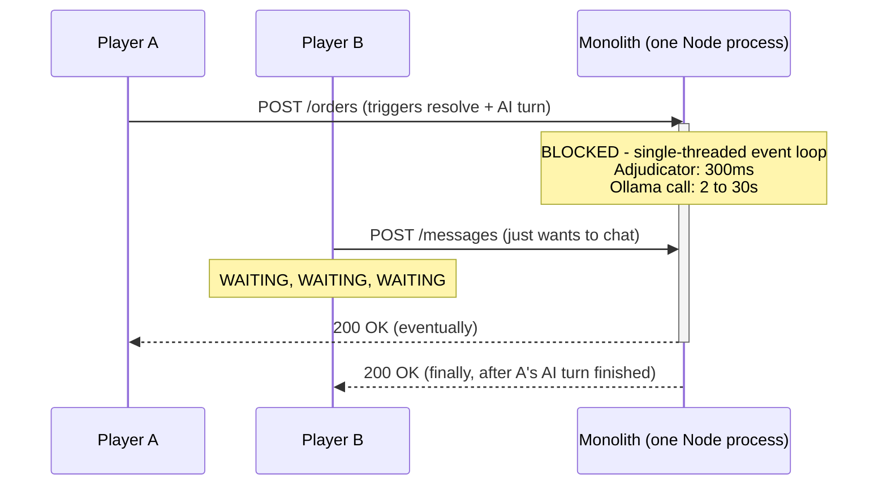

Node is single-threaded. One CPU-heavy or network-blocking handler freezes every other request. Chat feels dead during AI turns.

**After (backend + worker split):**

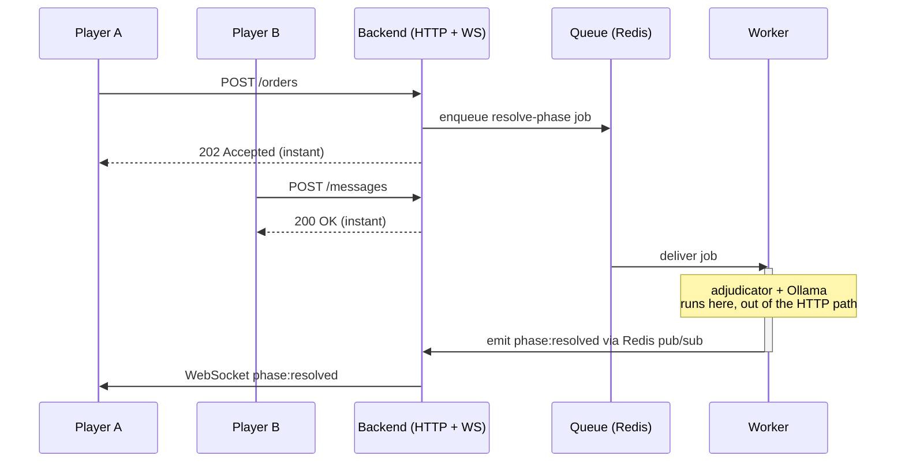

Backend stays responsive. Worker does the slow stuff. Players don't notice.

### 2.2 Why OpenAPI contract instead of just defining routes?

**Before (sequential, no shared contract):**

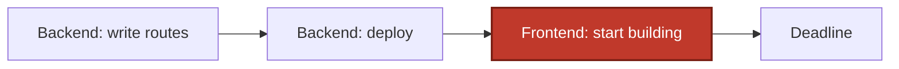

Frontend blocked waiting for backend. Serial work across the whole team.

**After (contract first, parallel work):**

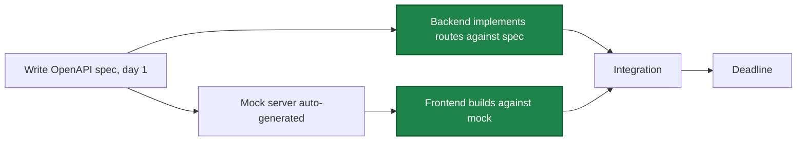

Backend and frontend work in parallel from day 1. Runtime validator at the API boundary catches any drift between code and spec. Teammates on frontend don't block on teammates on backend.

### 2.3 Why 3 cloud envs instead of 1?

**Before (one env):**

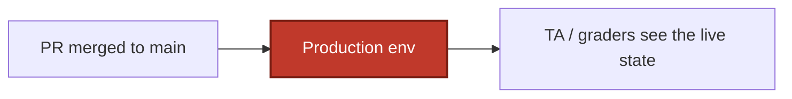

Every PR merge is one bad diff away from breaking the demo URL.

**After (dev auto, stage auto, prod gated):**

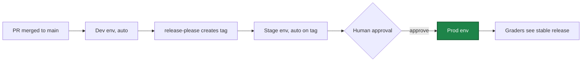

Bad merges land in dev. Stage proves the release pipeline works. Prod only moves after a human approves.

### 2.4 Why monorepo + shared packages?

**Before (one `src/`, 5 people):**

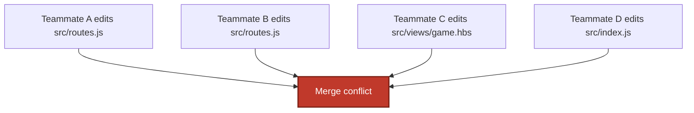

5 people fighting the same files. Constant merge pain.

**After (monorepo with per-stream ownership):**

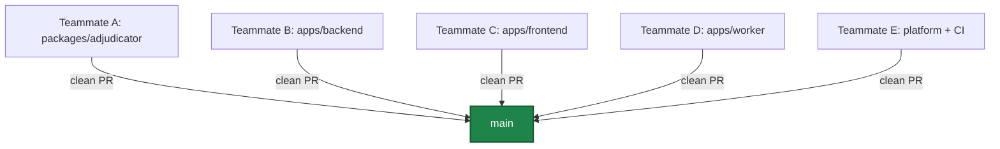

Each teammate owns a workstream. Shared pieces (contracts, adjudicator, game-types) live in `packages/` where a type change ripples with TypeScript compiler safety to every consumer. In the lab scaffold's single `src/`, the same ripple is "hope you grepped carefully."

### 2.5 Why Redis AND Postgres (not just Postgres)?

Two separate things both want Redis, so we add one Redis and let both use it:

1. **BullMQ job queue**, persists delayed jobs through restarts. `setTimeout` for a 24h deadline dies on the next deploy; Redis-backed jobs don't.
2. **Socket.IO pub/sub adapter**, lets the worker emit WebSocket events to clients connected to any backend replica.

Both roles are purpose-built for Redis. Postgres can technically do either, poorly.

### 2.6 What we kept vs changed

**Kept from the lab stack:**
- Node + Express + pg-promise + PostgreSQL (the backbone)
- bcryptjs + express-session (lab auth pattern)
- Mocha + Chai (lab testing)
- Docker Compose for local dev
- Raw SQL for schema (just incremental via node-pg-migrate)

**Added for what the proposal commits to:**
- React SPA + Vite (interactive board + chat; Handlebars can't do that)
- Socket.IO + Redis adapter (real-time chat + board updates)
- BullMQ + worker process (24h deadlines + AI turns in the background)
- OpenAPI contract (parallel frontend/backend work across 5 teammates)
- Monorepo + shared packages (team scaling + type safety across apps)
- 3 cloud envs with approval gate (demo-day safety)
- Microsoft OAuth (university-friendly login)

**Deliberately NOT adopted:**
- Kubernetes / Helm / Pulumi (overkill for 3 containers)
- Microservices (we have 3 processes, not 30)
- Module federation, service mesh, distributed tracing (100-engineer-org stuff)

### 2.7 TL;DR

Every architectural piece exists to satisfy a specific thing the proposal committed us to:

- Skip the backend/worker split, chat freezes during AI turns.
- Skip the OpenAPI contract, frontend sits idle waiting for backend.
- Skip the 3-env pipeline, one bad merge breaks the demo URL.
- Skip the monorepo, 5 people merge-conflict their way through 4 weeks.
- Skip Redis, deadlines evaporate on every deploy.

Starting with the right shape costs ~2 days of solo scaffolding at the start of M1 and saves the whole team from retrofitting these pieces one at a time under deadline pressure.

---

## 3. Goals & Non-Goals

### Goals (MVP)

- 7-player classic Diplomacy map with full orders (Hold / Move / Support / Convoy / Retreat / Build)
- In-game chat: public channel + private 1:1 DMs (white press)
- Ready-check turn advancement with grace period + 24h deadline fallback
- AI opponent via Ollama with persistent memory, alliances, and betrayals
- Civil Disorder handling for AFK players
- 3-env deployment pipeline (dev / stage / prod)
- Microsoft OAuth login (plus password auth)

### Non-Goals (deliberately deferred)

- Group chats (3+ player channels)
- Spectator mode
- Mid-game replacement players
- Non-DIAS draw voting (specific-subset draws)
- Multi-variant map support (chaos, modern, etc.)

---

## 4. Use Cases

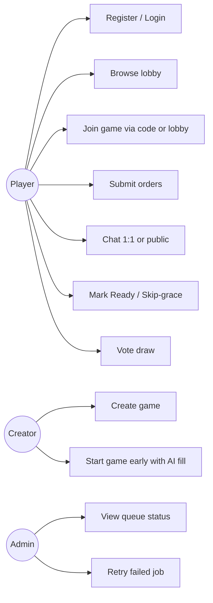

---

## 5. System Architecture

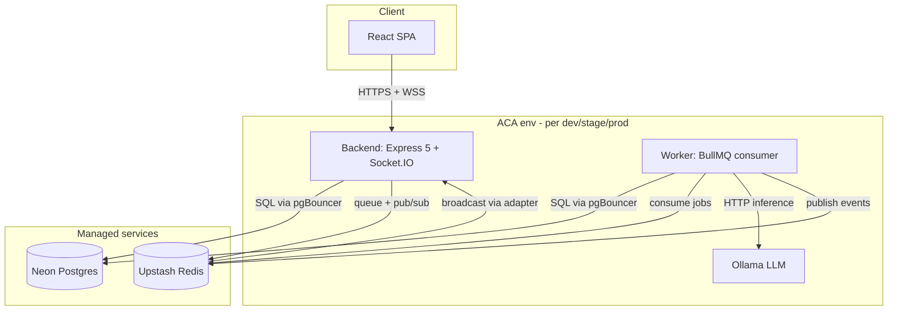

Each of the three environments (dev, stage, prod) is a fully isolated instance of the above. No shared infrastructure between envs.

---

## 6. Component Breakdown

### Monorepo layout

```
ProjectSourceCode/
├── apps/
│   ├── backend/     Express 5 + Socket.IO HTTP/WS server
│   ├── frontend/    Vite + React SPA
│   └── worker/      BullMQ consumer for jobs
├── packages/
│   ├── contracts/   OpenAPI spec + generated types + Socket.IO event types
│   ├── adjudicator/ Pure JS Diplomacy rules engine
│   └── game-types/  Shared TS types + classic-map.json
├── platform/
│   └── docker/      Shared Dockerfile bases
└── .github/
    ├── labeler.yml  Path-to-label rules for actions/labeler
    └── workflows/   Flat per-concern CI
```

### Responsibility matrix

| Component | Responsibility | Depends on |
|---|---|---|
| `apps/backend` | HTTP API + WebSocket server; auth; OpenAPI validation at request/response | `packages/contracts`, `packages/game-types`, `packages/adjudicator` (validation) |
| `apps/worker` | BullMQ job consumer: resolve phases, process AI turns | `packages/contracts`, `packages/game-types`, `packages/adjudicator` |
| `apps/frontend` | React SPA; interactive SVG board; chat UI | `packages/contracts` (generated client), `packages/game-types` |
| `packages/contracts` | OpenAPI spec + bundled artifacts + Kubb client + MSW handlers + Socket.IO event types | none |
| `packages/adjudicator` | Pure functions: `resolve()`, `getLegalMoves()`; DATC test suite | `packages/game-types` |
| `packages/game-types` | Shared TS types for board/orders/phases; static `classic-map.json` | none |

---

## 7. Data Model

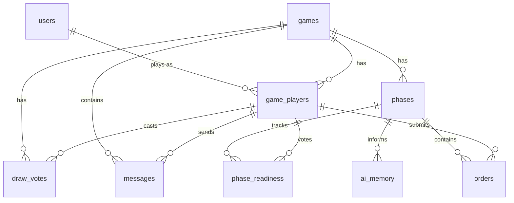

### Table purposes

| Table | Purpose | Notes |
|---|---|---|
| `users` | Base identity, auth credentials | `password_hash` nullable (OAuth users); `(oauth_provider, oauth_subject)` UNIQUE when non-null |
| `games` | Game instances with lifecycle metadata | `status` ∈ `forming / active / finished / abandoned` |
| `game_players` | Many-to-many between users and games; captures role (power), AI status, AFK counter | `user_id` NULL for AI slots; `power` randomly assigned at start |
| `phases` | Game clock: one row per phase, with board snapshot JSON | `phase_type` ∈ `movement / retreat / build` |
| `orders` | Per-unit orders per phase; adjudicator fills `result` post-resolution | Many per phase |
| `phase_readiness` | Per-player per-phase ready + skip-grace votes | Row absent = not ready; reset each phase |
| `draw_votes` | DIAS draw vote tracking per player per game | All survivors with row = draw |
| `ai_memory` | AI's persistent strategic notes (alliances, promises, grudges) | Isolated per `(game_id, power)` |
| `messages` | Chat (public or private 1:1) | `to_player_id` NULL = public |
| `session` | Managed by `connect-pg-simple`; cookie-based sessions | We don't write SQL against it |

Schema managed by `node-pg-migrate`, files in `apps/backend/db/migrations/`.

---

## 8. API Design

OpenAPI 3.1 contract-first. Spec lives at `packages/contracts/api/public/openapi.yaml`. All endpoints validated at runtime (request + response) by `express-openapi-validator`.

### Endpoint summary

| Group | Method | Path | Purpose |
|---|---|---|---|
| Auth | POST | `/auth/register` | Password registration |
| Auth | POST | `/auth/login` | Password login |
| Auth | POST | `/auth/logout` | Clear session |
| Auth | GET | `/auth/me` | Current user |
| Auth (OAuth) | POST | `/auth/oauth/microsoft/login` | Returns OIDC auth URL |
| Auth (OAuth) | GET | `/auth/oauth/microsoft/callback` | Code exchange + session start |
| Games | GET | `/games` | List games (lobby) |
| Games | POST | `/games` | Create game |
| Games | GET | `/games/:id` | Get game detail |
| Games | POST | `/games/:id/join` | Join (by code or open slot) |
| Games | POST | `/games/:id/start` | Creator starts early with AI fill |
| Games | POST | `/games/:id/draw-vote` | Toggle draw vote |
| Games | DELETE | `/games/:id/draw-vote` | Remove draw vote |
| Phases | GET | `/games/:id/phases/current` | Current phase state |
| Phases | POST | `/games/:id/phases/current/resolve-now` | Dev-only manual resolve |
| Orders | GET | `/games/:id/phases/current/orders` | List own orders |
| Orders | PUT | `/games/:id/phases/current/orders` | Submit/update orders |
| Ready | POST | `/games/:id/phases/current/ready` | Mark ready |
| Ready | DELETE | `/games/:id/phases/current/ready` | Un-ready |
| Ready | POST | `/games/:id/phases/current/skip-grace` | Vote skip-grace |
| Messages | GET | `/games/:id/messages` | List messages |
| Messages | POST | `/games/:id/messages` | Send message |

### Socket.IO events

Not covered by OpenAPI. Typed via hand-written TS in `packages/contracts/sockets/events.ts`:

- `phase:resolved`, payload includes new board state + resolution results
- `ready:changed`, N/M counter update
- `skip-grace:changed`, N/M counter update
- `message:new`, new chat message
- `cd:changed`, civil disorder status change
- `game:ended`, game concluded (with reason)

---

## 9. Game Lifecycle State Machine


**Status transitions written by:**
- `forming → active`: `/games/:id/start` endpoint or auto-trigger when 7th human joins
- `active → finished`: worker after Winter/Build phase (solo detection) or on draw-vote update
- `active → abandoned`: worker after resolving a phase that marks the 3rd consecutive inactive one

---

## 10. Phase Resolution Flow

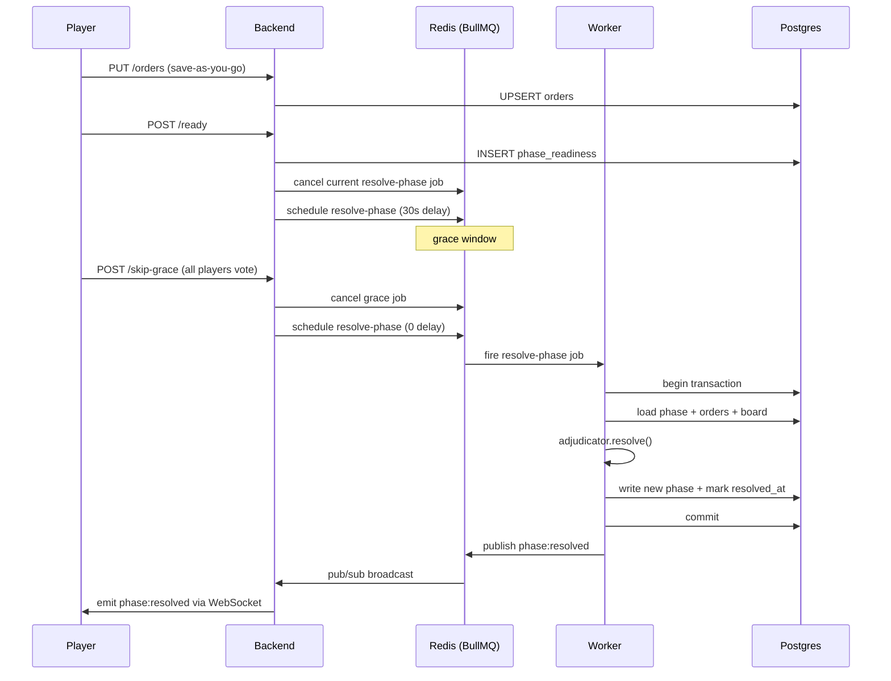

**Resolution triggers (in priority order):**

1. **Unanimous skip-grace** → immediate
2. **All affected ready + 30s grace elapsed** → scheduled
3. **24h deadline reached** → fallback (missing orders → Hold)

---

## 11. AI Turn Flow

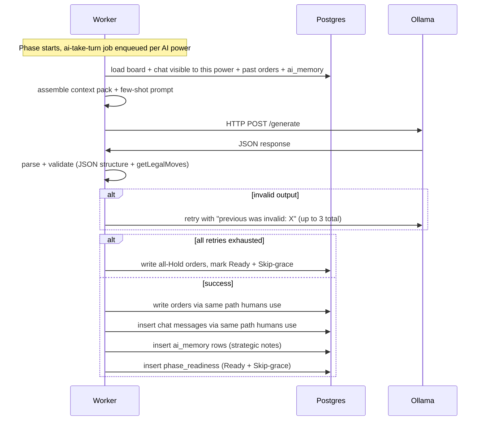

**Why stateless workers + stateful DB**: the AI's "memory" lives entirely in Postgres (chat log, past orders, `ai_memory`). No in-memory agent, no per-game process. Scales trivially via BullMQ worker replicas.

---

## 12. Realtime Communication

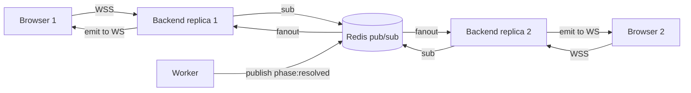

**Socket.IO rooms:**
- `game:<id>`, all players in a game (public events + public chat)
- `game:<id>:player:<player_id>`, single player (private DMs addressed to them)

**Auth**: HTTP session cookie flows into the WS handshake via `io.engine.use(sessionMiddleware)`. One auth system end-to-end.

**Transport**: WebSocket only (no polling fallback). Avoids sticky load balancing requirements.

**Reconnection**: client retries 10 times with exponential backoff; surfaces a sonner toast on exhaustion.

---

## 13. CI/CD Pipeline

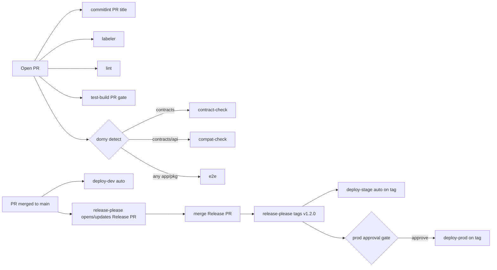

**Workflow trigger table:**

| Workflow | Trigger | Purpose |
|---|---|---|
| `commitlint.yml` | PR open/sync | Lints PR title against conventional-commit format. Required check. |
| `labeler.yml` | PR open/sync | Auto-adds `area:*` labels based on changed paths. |
| `lint.yml` | PR open/sync | ESLint + Prettier + typecheck. Always runs. |
| `test-build.yml` | PR open/sync | Full build + unit tests + E2E against Compose stack. Uses `environment: dev` for secret scope but does NOT deploy. Acts as the deployability check. |
| `contract-check.yml` | PR open/sync (if `packages/contracts/**` changed) | Regen contracts, assert no diff. |
| `compat-check.yml` | PR open/sync (if `packages/contracts/api/**` changed) | oasdiff vs base branch. Fails on breaking changes without `breaking-change-approved` label. |
| `e2e.yml` | PR open/sync (if any `apps/**` or `packages/**` changed) | Playwright E2E + Postman contract tests against a Compose stack. |
| `deploy-dev.yml` | `push: branches: [main]` | Auto-deploys to dev ACA env on PR merge. |
| `release-please.yml` | `push: branches: [main]` | Updates the Release PR with CHANGELOG + version bump based on conventional-commit types since last release. |
| `deploy-stage.yml` | `push: tags: ['v*']` | Auto-deploys to stage ACA env when release-please creates a tag. |
| `deploy-prod.yml` | `push: tags: ['v*']` | Deploys to prod ACA env. Requires reviewer approval via `prod` GH environment config. Same tag drives both stage and prod. |
| `discord-pr.yml` | PR open | Existing Discord notification. |

**Change detection via dorny/paths-filter**: conditional workflows still trigger on every PR (keeps branch protection happy) but gate their jobs with `if: needs.detect.outputs.X == 'true'`. A no-op workflow still reports success.

**Dependency propagation**: changing `packages/contracts/**` triggers backend AND frontend AND worker tests. Changing `packages/game-types/**` or `packages/adjudicator/**` triggers all consumers.

**release-please + conventional commits:**
- Commit messages and PR titles follow conventional format (`feat:`, `fix:`, `chore:`, `docs:`, `test:`, `refactor:`, `BREAKING CHANGE:` or `feat!:`).
- `commitlint.yml` enforces this on PR titles via `amannn/action-semantic-pull-request`.
- release-please accumulates merged PRs into a growing "Release PR" that describes the next release.
- Merging the Release PR creates the `v*` tag + GitHub Release, which triggers stage + prod deploys.
- Monorepo config: single root version (everything moves together). Independently versioned apps possible later.

**Deploy strategy summary:**
- **PR**: no cloud deploy. `test-build.yml` runs a full build + test with dev-env secret scope as the deployability check.
- **PR merge → main**: `deploy-dev.yml` ships `main` to the shared dev ACA env. Dev always reflects HEAD of main.
- **Release PR merge**: release-please creates the tag → stage deploys automatically → prod waits for human approval, then deploys.

---

## 14. Tech Stack Decisions

For each decision below, the **recommended** choice is what we plan to implement. The **next-best** alternative is a legitimate direction we considered, team members should raise objections before M2 if they prefer the alternative.

| Decision | Recommended | Pros | Cons | Next-best | Alt pros | Alt cons |
|---|---|---|---|---|---|---|
| Language | **TypeScript everywhere** | Compile-time safety across monorepo; Kubb hooks + OpenAPI types fully leveraged | Build step; some teammate ramp-up | Plain JavaScript | Zero build; matches labs | Loses most of OpenAPI/Kubb value; adjudicator correctness relies on runtime |
| HTTP framework | **Express 5** | Lab-aligned; native async + rejection handling built in | Older design than Fastify | Fastify | 2-5x faster; built-in JSON schema validation | Different ecosystem; team ramp-up |
| DB client | **pg-promise** | Lab standard; direct SQL for complex adjudication queries | No typed query results; migrations external | Drizzle ORM | Fully typed queries; migrations built-in | Learning curve; inverts "SQL is truth" lab convention |
| OpenAPI validation | **express-openapi-validator** | Spec is source of truth; enforced at request + response time | Reflection overhead; opaque deep-schema errors | Zod schemas → generate OpenAPI | Code as truth; best TS inference | Inverts contract-first; loses human-authored spec |
| Session store | **connect-pg-simple** | Postgres already present; durable | 1 SELECT per authenticated request | connect-redis | Sub-ms lookups | Durability depends on Redis AOF |
| Password hashing | **bcryptjs** | Pure JS; no native compile | ~10x slower than native (fine for login rate) | argon2 | Modern; GPU-resistant | Native compile; node-gyp pain in Alpine |
| OAuth library | **openid-client** | Generic OIDC; swap-in Google/GitHub later | Not Microsoft-specific | @azure/msal-node | Official Microsoft support | Azure-specific lock-in |
| Logger | **pino** | Fast, JSON-structured, request-scoped child loggers | Terminal readability needs pino-pretty | winston | More transport plugins | Slower; more config |
| Error handling | **Central middleware + plain `throw`** | Simple; Express 5 native async rejection | none | RFC 7807 Problem Details | Standardized error shape | More boilerplate |
| Realtime | **Socket.IO + Redis adapter** | Cross-replica broadcast; one auth system | Transport constrained to WS | Server-Sent Events (SSE) | Simpler; HTTP-only | One-way; needs separate POST for sends |
| Routing (frontend) | **React Router v7** | Dominant; team-familiar; rich ecosystem | Larger API surface | TanStack Router | Type-safe routes natively | Smaller community; different mental model |
| Server state | **TanStack Query (via Kubb)** | Industry standard; caching + mutations + invalidation | none | SWR | Smaller API | Less feature complete |
| Client state | **Zustand** | Minimal; atoms-based; tiny API | none significant | Jotai | Pure atoms model | Similar niche; smaller community |
| Styling | **Tailwind** | Utility-first; works great with Shadcn | Utility-class noise in JSX | CSS Modules | Scoped styles; conventional CSS | More files; no shared design tokens by default |
| Component library | **Shadcn/ui + Radix** | Own-the-code; unopinionated; accessible | More initial setup | Headless UI | Official Tailwind pairing | Smaller component set |
| Board rendering | **Import existing Diplomacy SVG + event delegation** | Fast to ship; art already correct | DOM-handler style less React-idiomatic | Hand-render each `<Province>` as React component | Fully React-idiomatic; props-driven | More upfront work |
| Forms | **React Hook Form** | Dominant; performant; Zod/Yup validation | One more dep | TanStack Form | Type-safe; matches other TanStack picks | Smaller community |
| Date/time | **date-fns** | Modular; tree-shakeable; functional | Functional API unfamiliar to Moment users | dayjs | Moment-compatible chaining; 2KB | Plugin-based for extras |
| Icons | **lucide-react** | 1,400+ icons; Shadcn default | none | Heroicons | Official Tailwind pairing | Smaller set |
| Toasts | **sonner** | Modern; 5KB; works with Tailwind | Newer, slightly less flexible | react-hot-toast | Battle-tested | Dated styling defaults |
| Queue library | **BullMQ** | TS-native; cancellation by ID (needed for grace); de-facto Node standard | Needs Redis | pg-boss | Postgres-only; one fewer service | Smaller community; less feature-complete |
| Postgres version | **16** | Current stable; better perf defaults | Minor divergence from lab image (14) | 14 (lab default) | Matches labs exactly | Missing LZ4 TOAST, newer JSON path |
| Migration tool | **node-pg-migrate** | Node-native; zero infra; SQL migrations | Migration directory on us | Flyway | Battle-tested industry standard | Pulls JVM into Docker |
| Pooling | **pg-promise + pgBouncer** | Scales with replicas without exhausting max_connections | Transaction-mode quirks | pg-promise built-in pool only | Zero extra infra | Can exhaust max_connections at scale |
| Mock servers | **Postman (dev) + MSW (frontend tests)** | Both worlds: shared team mock URL + in-browser test mocks | Two mock sources to maintain | Postman only | One source | Loses frontend-test mocking without HTTP |
| Monorepo | **pnpm workspaces** | Fast installs, strict hoisting (prevents phantom deps), first-class monorepo support, works great with Turborepo later if needed | One more tool to install locally; diverges slightly from the labs' npm defaults | npm workspaces | Lab-aligned; zero new tool to install | Slower installs; looser hoisting lets phantom deps slip in |
| Monorepo task runner | **Make + pnpm scripts** | Universal; no new DSL; `pnpm -r` fans out across workspaces | Verbose per-target scripts | Turborepo | Build caching; task orchestration | New tool; config overhead |
| Compose organization | **Single docker-compose.yaml** | Simplest | Dev tweaks mix with service def | Base + override files | Clean prod-like split | Two files to understand |
| Node base image | **node:20-alpine** | Smaller; works with our pure-JS deps | musl can break some native deps | node:20 (Debian-slim) | Works with every native dep | Larger image |
| Secrets handling | **.env per app locally; GH env secrets in cloud** | Lab convention; built-in approval gates | none | Doppler free tier | Cloud secret manager; audit log | New signup; cloud dep |
| CI structure | **Flat per-concern workflows** | Easy to grep; one file per concern | Setup duplication across workflows | Reusable via workflow_call | DRY; shared steps across workflows | Indirection; more files |
| Change detection | **Labeler + dorny/paths-filter** | GH-native; branch protection stays happy | More per-workflow config | Trigger-level path filters | Simpler config | Breaks branch protection on required skipped checks |
| Deploy target | **Azure Container Apps + Neon + Upstash** | Native KEDA queue scaling; generous free tier; Azure familiarity | Azure lock-in for compute | AWS ECS Fargate + RDS + ElastiCache | Massive ecosystem; AWS familiarity common | No scale-to-zero; weaker free tier; ~$60-100/mo for 3 envs |
| AI runtime | **Ollama local in ACA** | Zero API cost; works offline; stateless | GPU-less inference is slow | Cloud API (OpenAI/Groq/Gemini) | Faster + better output; parallelism | Costs money; API key management; network dep |
| AI model | **llama3.1:8b** | Well-rounded; popular; cheap | 8B occasional hallucination | qwen2.5:7b | Strong structured output | Less-tested in community |
| AI output format | **Prompt-requested JSON + 3 retries** | Works with any model; simple | Retries cost latency | Grammar-constrained JSON (Ollama `format: json`) | Always parseable | Slower generation; newer feature |
| Backend testing | **Mocha + Chai** | Matches lab stack | Older than Vitest | Vitest | Faster; unified with frontend | Diverges from lab convention |
| Frontend testing | **Vitest + Playwright + MSW** | Modern; Vite-native; MSW works great for API mocking | none significant | Jest + Cypress + Nock | Older but still common | Slower; dated |
| Test DB isolation | **Per-test transaction + rollback** | Fast; isolated; no cleanup bugs | Can't use nested transactions in tests | Per-test fresh schema | Allows nested txns | Slower per test |
| DATC organization | **One file per section (~9 files)** | Manageable; maps to milestone progress | Files grow to 15+ cases each | One file per case (~60+ files) | Atomic PRs | Overwhelming directory |

### Decisions explicitly open to team pushback before M2

If anyone on the team has a strong preference for the alternative, flag it in a PR comment on this doc **before** M2 implementation begins (end of week 1):

- **Backend testing framework**, Vitest vs Mocha+Chai (lab alignment vs modernity)
- **Monorepo task runner**, Make vs Turborepo (simple vs faster builds)
- **AI runtime**, Local Ollama vs cloud API (free vs quality)
- **DB client**, pg-promise vs Drizzle (lab vs TS-first)
- **Routing**, React Router vs TanStack Router (dominant vs type-safe)

Other decisions are more locked (e.g., Express 5 matches the lab stack directly; swapping is a day-of-sprint risk).

---

## 15. Security Considerations

| Concern | Mitigation |
|---|---|
| **SQL injection** | pg-promise parameterized queries exclusively; no string concatenation. express-openapi-validator rejects malformed input before it reaches handlers. |
| **Password storage** | bcryptjs with cost factor 10+. Never log passwords. |
| **Session hijacking** | HTTP-only cookies; `SameSite=None; Secure` (HTTPS enforced in all envs). Sessions stored in Postgres (survives backend restarts). |
| **XSS** | React auto-escapes by default. No `dangerouslySetInnerHTML` on user input. Content Security Policy header via helmet. |
| **CSRF** | SameSite cookie attribute as primary defense. Explicit CSRF tokens if we add state-changing GET requests (we don't). |
| **Rate limiting** | express-rate-limit backed by Redis, 30 messages/min per player per game on chat. Future expansion to other endpoints. |
| **OAuth** | PKCE flow via openid-client. State parameter validated server-side. Nonce for ID token replay protection. |
| **Secrets** | Never committed. `.env` gitignored; cloud env values in GH environment secrets with reviewer gate on prod. |
| **Dependency vulnerabilities** | Dependabot alerts enabled. `pnpm audit` in CI. |
| **AI prompt injection** | AI output validated structurally (JSON schema) and semantically (`getLegalMoves()`) before any DB write. AI can't inject arbitrary chat since chat is routed through the normal send-message path (same rate limits + validation). |
| **Admin UI** | Bull Board behind basic auth, admin password in GH env secrets. Not exposed on frontend domain. |

---

## 16. Observability

| Signal | Where it lives | Who reads it |
|---|---|---|
| **Backend logs** | pino JSON output → ACA container logs → Azure Log Analytics | Devs during debugging |
| **Worker logs** | Same as backend | Devs; worker failures also hit Discord |
| **Request IDs** | pino child logger per request with `req_id`, `user_id`, `game_id` | Trace a single request across logs |
| **Queue state** | Bull Board at `/admin/queues` with basic auth | WS-4 (platform) during debugging |
| **Job failures** | BullMQ `queue.on('failed')` → Discord webhook | Whole team via existing Discord server |
| **CI results** | GitHub Actions UI | Everyone on PR |
| **Deploy status** | GitHub Actions UI + Azure portal | WS-4 (platform owner) |

### Deliberate non-goals (observability)

- No Prometheus/Grafana (overkill for 4-week scope)
- No distributed tracing (we're small enough that logs + request IDs suffice)
- No APM (New Relic, Datadog, etc.)

---

## 17. Milestones

See the full week-by-week breakdown in the implementation plan. Summary:

| Week | Theme | Owner-weight |
|---|---|---|
| 1 | Scaffold (WS-4 solo, days 1-3) + auth + lobby | WS-4 heavy |
| 2 | Chat + realtime + more adjudication | WS-3 (Frontend) heavy |
| 3 | Deadlines + builds + AI integration starts | WS-4 + WS-5 (AI) heavy |
| 4 | AI polish + prod cutover + demo | WS-5 + WS-3 heavy; everyone on bug fixes last 2 days |

### Workstreams

| Stream | Owner | Responsibility |
|---|---|---|
| WS-1 | TBD | `packages/adjudicator`, `packages/game-types`, DATC test suite |
| WS-2 | TBD | `apps/backend`, migrations, OpenAPI spec, session + auth |
| WS-3 | TBD | `apps/frontend`, SVG board, chat UI, lobby, order entry |
| WS-4 | TBD | `apps/worker`, Docker Compose, GH Actions, Azure ACA, Neon/Upstash provisioning + PM + flex |
| WS-5 | TBD | AI prompt + Ollama integration, Playwright E2E, Postman contract tests, MSW setup |

---

## 18. Risks & Mitigations

| Risk | Severity | Mitigation |
|---|---|---|
| **Adjudicator correctness**, writing a Diplomacy rules engine from scratch is famously edge-case heavy (60+ DATC cases) | High | Treat as isolated math library; port DATC cases from day 1; each PR touching adjudicator must keep DATC green; one file per DATC section maps to milestone progress |
| **4-week timeline is 3.25x the per-week velocity of a semester plan** | High | Explicit ship-list vs stretch-list per week; clear slip order so cuts aren't improvised at the last moment |
| **AI quality** on local Ollama may be poor | Medium | Acceptance threshold is "AI submits legal orders consistently," not "AI plays well." Fallback to all-Hold if 3 retries fail. Context pack can be iteratively improved |
| **User authentication / data security** | High | bcryptjs, parameterized queries, SameSite cookies, HTTPS everywhere, OAuth via standard OIDC flow |
| **Cross-env config drift** | Medium | GH env secrets + ACA environment separation prevent values leaking. Infrastructure identical across envs (only values differ) |
| **Teammate schedule disruption** (illness, etc.) | Medium | WS-4 holds flex-support role across all streams. WS-1 (adjudicator) is pure JS and self-contained, easy for any stream to help with |
| **Compose startup complexity** | Low | WS-4 scaffolds everything in M1; teammates don't touch framework config |

---

## 19. Open Questions

- Final deploy URLs for each env (TBD during M1 Azure standup)
- Specific `llama3.1:8b` or `llama3.1:8b-q4_K_M` for grading demo (depends on grading-machine specs)
- Whether to add Google/GitHub OAuth alongside Microsoft (parked post-MVP)
- Whether to display a global "Diplomacy clock" (world year, not real time) prominently in the UI (nice-to-have)

---

## 20. References

- [Diplomacy rulebook (Avalon Hill)](https://www.wizards.com/avalonhill/rules/diplomacy.pdf)
- [DATC, Diplomacy Adjudicator Test Cases](http://web.inter.nl.net/users/L.B.Kruijswijk/) by Lucas Kruijswijk
- [diplicity-react](https://github.com/johnpooch/diplicity-react), inspiration for feature set and UI patterns
- [godip](https://github.com/zond/godip), Go-based Diplomacy adjudicator used by diplicity (reference for edge cases)

---

## 21. Decision Log

Append-only. Record *when* a decision was finalized, *who* approved, *why* over the alternative. New decisions mid-project also logged here.

| Date | Decision | Approved by | Rationale |
|---|---|---|---|
| 2026-10-27 | Initial tech stack per section 14 | Pending team review | See per-row Pros/Cons |
| 2026-10-27 | 3 isolated cloud envs (dev/stage/prod) on Azure Container Apps | Pending team review | Scale-to-zero + queue-triggered scaling via KEDA + generous free tier |
| 2026-10-27 | Microsoft OAuth added as additional (not replacement) login method | Pending team review | University students have Microsoft accounts; one-click signup; openid-client lets us add Google/GitHub later |
| | | | |
