# Diplomacy Online, Design Document

**Team**: The Diplomats<br>
**Members**: Nathaniel Blucher, Deven Chen, Brynne Geittmann, Rez Haleem, Justin Kurtz<br>
**Repo**: https://github.com/The-Diplomats/Diplomacy<br>
**Status**: v1

---

## 1. Overview

Diplomacy Online is a web-based implementation of the 1950s strategy board game Diplomacy. Players compete across a map of pre-WWI Europe to capture supply centers through negotiation, strategic maneuvering, and betrayal. The application supports 2-7 players per game, in-game chat (both public and private), deadline-based asynchronous play, and AI opponents powered by a locally-hosted LLM.

---

## 2. Why This Architecture (vs the Current Scaffolding)

The repo currently used to have a Lab-style scaffold: single Node/Express app, Handlebars views, raw SQL in `src/init_data/`, everything in one process. That worked for Lab 7's hiking CRUD. It breaks under what our proposal commits to. This section shows **why**, using before/after visuals for the key decisions.

### 2.1 Why split backend and worker?

**Before (one Node process, lab scaffold):**

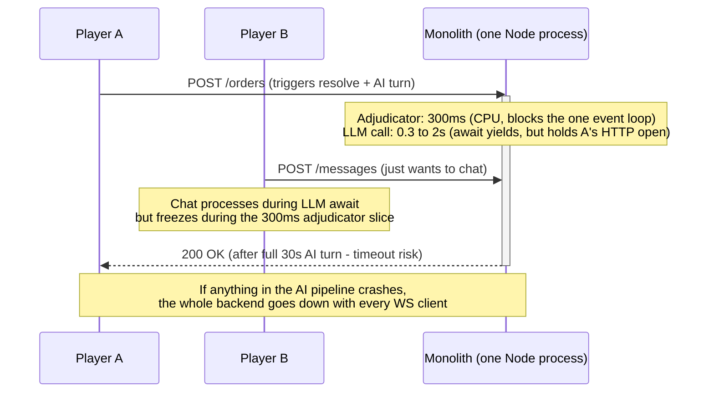

Node has one main thread running one event loop. "Non-blocking I/O" means `await db.query()` and `await groq.chat.completions.create()` yield the loop — other handlers _can_ run during the wait. So the LLM call alone doesn't freeze chat. But three real problems remain in a monolith:

1. **The adjudicator (~300ms) is pure CPU.** No `await` to yield on. The one event loop is genuinely frozen during that slice; every other handler stalls.
2. **The player's HTTP request can't wait 30 seconds.** Even if the loop stays free, browsers time out around 30-60s on fetch, and "button spinning for half a minute" is bad UX regardless. The response has to come back fast.
3. **A single crash takes everyone down.** If the LLM call throws, if the parser hits malformed JSON, if memory spikes — the whole backend process dies and every connected WebSocket client drops.

**After (backend + worker split):**

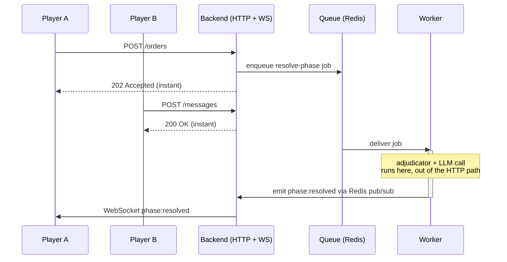

Backend returns 202 instantly. The 300ms CPU block and the LLM round-trip both move to the worker, out of any HTTP response path. A worker crash is contained — BullMQ retries the job and the backend keeps every WS connection alive. Separate processes also mean independent scaling (worker on queue depth via KEDA; backend on HTTP connection count) and separate memory accounting.

### 2.2 Why TypeScript instead of plain JavaScript (like the labs)?

**Before (plain JS, lab pattern):**

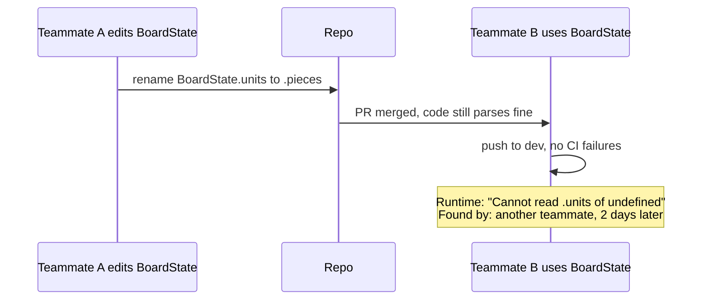

A shared-type change in a monorepo without compile-time types ripples silently to every consumer. The failure happens at runtime, usually in a different workstream than the one that caused it, often days later.

**After (TypeScript):**

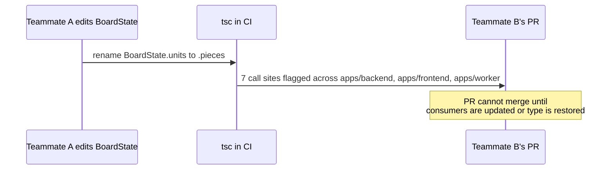

The compiler surfaces every consumer in CI before the PR merges. For 5 people simultaneously changing shared packages (`contracts`, `adjudicator`, `game-types`), this is the difference between "it works on my machine" and "it worked when the whole team pushed it."

**Three concrete payoffs beyond the renamed-field example:**

1. **OpenAPI codegen (next section) only pays off with TS.** Kubb generates typed React Query hooks like `useSubmitOrders({ orders: Order[] })`. In plain JS, you'd still call the hook, but the editor can't autocomplete the payload shape and the compiler can't catch typos. The whole contract-first architecture degrades to "generated code is decoration."

2. **The adjudicator is intricate-typed logic.** `BoardState`, `Order`, `Resolution`, `SupportChain`, `DislodgedUnit`, `ConvoyRoute`, each with multiple variants. The TS compiler catches "I passed a build order to the retreat resolver" before DATC tests even run.

3. **Refactor safety for 5 people on shared packages.** Rename a field in `packages/game-types` and the TypeScript compiler shows every file that breaks across all three apps + three packages. In JS, you grep carefully and hope.

**Cost:** one `tsc --watch` process in dev, slightly slower iteration on exploratory code (occasional "the compiler is yelling at me"), one additional ramp-up topic for teammates less familiar with TypeScript. Standard tradeoff for a monorepo at team scale.

### 2.3 Why OpenAPI contract instead of just defining routes?

**Before (sequential, no shared contract):**

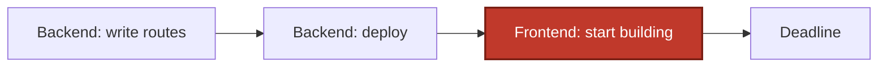

Frontend blocked waiting for backend. Serial work across the whole team.

**After (contract first, parallel work):**

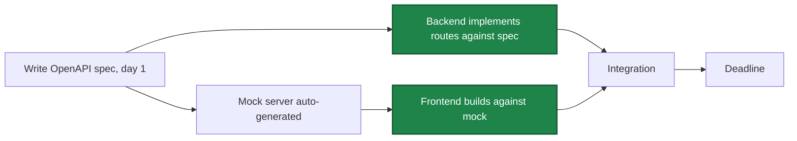

Backend and frontend work in parallel from day 1. Runtime validator at the API boundary catches any drift between code and spec. Teammates on frontend don't block on teammates on backend.

### 2.4 Why 3 cloud envs instead of 1?

**Before (one env):**

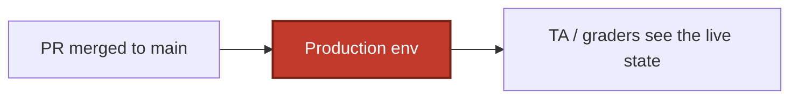

Every PR merge is one bad diff away from breaking the demo URL.

**After (dev auto, stage auto, prod gated, with E2E gates at each tier):**

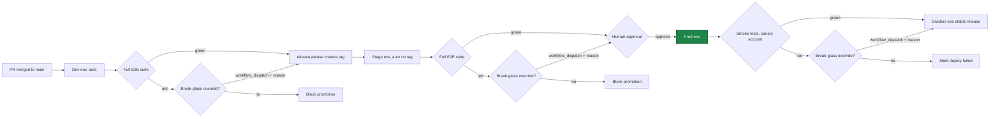

Each gate has a **break-glass override**: manually invoking the next workflow via `workflow_dispatch` with a required `reason` input skips the E2E check. The prod approval gate still holds. Override use is intentionally auditable: the reason lives in the workflow log, and the manual trigger records the actor. See §13 for the exact inputs.

Each env has a purpose and a test gate:

- **Dev** catches regressions cheaply. Full E2E suite against scenario-seeded dev DB blocks promotion to stage.
- **Stage** proves the release pipeline works. Full E2E suite against scenario-seeded stage DB is the last fully-isolated correctness gate before prod.
- **Prod** is behind both human approval *and* post-deploy smoke tests. Smoke tests use a pre-provisioned canary account (no seeding on real-user data) and prove only that the deploy itself worked: containers up, DB reachable, auth intact. Real users are never behind pre-approval test writes.

Bad merges land in dev and fail the dev E2E suite before reaching stage. See §6 for how the scenario seeders work and §13 for the workflow wiring.

### 2.5 Why monorepo + shared packages?

**Before (one `src/`, 5 people):**

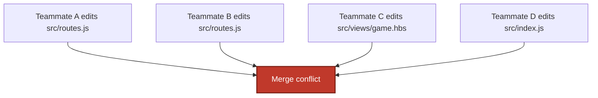

5 people fighting the same files. Constant merge pain.

**After (monorepo with per-stream ownership):**

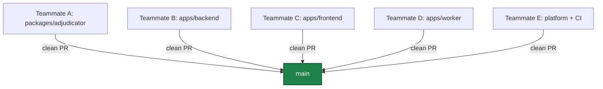

Each teammate owns a workstream. Shared pieces (contracts, adjudicator, game-types) live in `packages/` where a type change ripples with TypeScript compiler safety to every consumer. In the lab scaffold's single `src/`, the same ripple is "hope you grepped carefully."

### 2.6 Why Redis AND Postgres (not just Postgres)?

Two separate things both want Redis, so we add one Redis and let both use it:

1. **BullMQ job queue**, persists delayed jobs through restarts. `setTimeout` for a 24h deadline dies on the next deploy; Redis-backed jobs don't.
2. **Socket.IO pub/sub adapter**, lets the worker emit WebSocket events to clients connected to any backend replica.

Both roles are purpose-built for Redis. Postgres can technically do either, poorly.

### 2.7 What we kept vs changed

**Kept from the lab stack:**

- Node + Express + PostgreSQL (the backbone)
- Password hashing + express-session (lab auth pattern, now with Node-native `crypto.scrypt`)
- Docker Compose for local dev
- Incremental schema evolution via committed SQL files

**Added for what the proposal commits to:**

- React SPA + Vite (interactive board + chat; Handlebars can't do that)
- Socket.IO + Redis adapter (real-time chat + board updates)
- BullMQ + worker process (24h deadlines + AI turns in the background)
- OpenAPI contract (parallel frontend/backend work across 5 teammates)
- Monorepo + shared packages (team scaling + type safety across apps)
- 3 cloud envs with approval gate (demo-day safety)
- Microsoft OAuth (university-friendly login)

**Deliberately NOT adopted:**

- Kubernetes / Helm / Pulumi (overkill for 3 containers)
- Microservices (we have 3 processes, not 30)
- Module federation, service mesh, distributed tracing (100-engineer-org stuff)

---

## 3. Goals & Non-Goals

### Goals (MVP)

- 7-player classic Diplomacy map with full orders (Hold / Move / Support / Convoy / Retreat / Build)
- In-game chat: public channel + private 1:1 DMs (white press)
- Ready-check turn advancement with grace period + 24h deadline fallback
- AI opponent via Groq-hosted `llama-3.1-8b-instant` with persistent memory, alliances, and betrayals
- Civil Disorder handling for AFK players (per-phase defaults; per-player lockout after 3 consecutive missed phases)
- 3-env deployment pipeline (dev / stage / prod)
- Microsoft OAuth login (plus password auth)

### Non-Goals (deliberately deferred)

- Group chats (3+ player channels)
- Spectator mode
- Mid-game replacement players
- Non-DIAS draw voting (specific-subset draws)
- Multi-variant map support (chaos, modern, etc.)

---

## 4. Use Cases

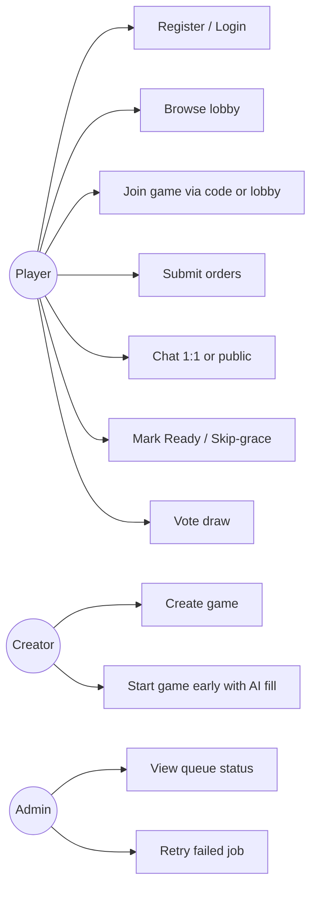

---

## 5. System Architecture

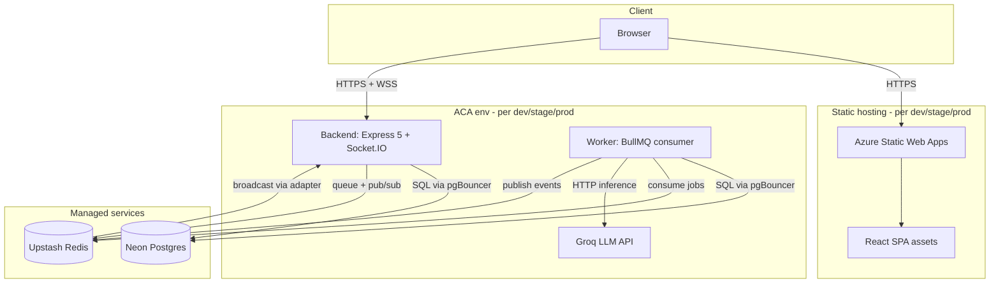

Each of the three environments (dev, stage, prod) is a fully isolated instance of the above. No shared infrastructure between envs.

---

## 6. Component Breakdown

### Repo layout (two levels)

GitHub Actions only scans `.github/workflows/` at the git repo root, so `.github/` lives at the top, outside the monorepo. The monorepo itself (pnpm workspace root) is `ProjectSourceCode/`.

```
Diplomacy/                              # git repo root
├── .github/
│   ├── labeler.yml                     # path-to-label rules for actions/labeler
│   ├── pull_request_template.md
│   └── workflows/                      # flat per-concern CI
├── MilestoneSubmissions/               # design doc, meeting minutes, submissions
├── TeamMeetingLogs/
└── ProjectSourceCode/                  # monorepo (pnpm workspace root)
    ├── apps/
    │   ├── backend/                    # Express 5 + Socket.IO HTTP/WS server
    │   ├── frontend/                   # Vite + React SPA
    │   └── worker/                     # BullMQ consumer for jobs
    ├── packages/
    │   ├── contracts/                  # OpenAPI spec + generated types + Socket.IO event types
    │   ├── adjudicator/                # pure-function Diplomacy rules engine (TS)
    │   ├── game-types/                 # pure TS domain types (BoardState, Order, Power) + classic-map.json
    │   ├── queues/                     # shared BullMQ queue definitions + typed job payloads
    │   └── db/
    │       ├── src/
    │       │   ├── schema/             # one-table-per-file Drizzle definitions (users, games, players, session, verification-tokens)
    │       │   ├── client.ts           # createDbClient(DATABASE_URL) factory
    │       │   └── index.ts            # re-exports schema + client
    │       ├── migrations/             # drizzle-kit generated .sql + meta/
    │       └── drizzle.config.ts       # drizzle-kit config

    # Seeding + E2E state (see "Test data strategy" below)
    # apps/backend/src/scripts/seed.ts            # dev-bootstrap: teammate accounts; NODE_ENV=production guarded
    # apps/backend/src/scripts/scenarios/         # E2E scenario seeders (`pnpm seed:scenario <name>`)
    # apps/frontend/e2e/                          # Playwright specs + fixtures (auth, scenarios)
    ├── platform/
    │   └── docker/                     # shared Dockerfile bases
    ├── pnpm-workspace.yaml
    ├── package.json
    └── docker-compose.yaml
```

### Responsibility matrix

| Component              | Responsibility                                                                                                                                                                                                                                                                             | Depends on                                                                                      |
| ---------------------- | ------------------------------------------------------------------------------------------------------------------------------------------------------------------------------------------------------------------------------------------------------------------------------------------ | ----------------------------------------------------------------------------------------------- |
| `apps/backend`         | HTTP API + WebSocket server; auth; OpenAPI validation at request/response                                                                                                                                                                                                                  | `packages/contracts`, `packages/game-types`, `packages/adjudicator` (validation), `packages/db` |
| `apps/worker`          | BullMQ job consumer: resolve phases, process AI turns                                                                                                                                                                                                                                      | `packages/contracts`, `packages/game-types`, `packages/adjudicator`, `packages/db`              |
| `apps/frontend`        | React SPA; interactive SVG board; chat UI; deployed as static artifact to Azure Static Web Apps per env                                                                                                                                                                                    | `packages/contracts` (generated client), `packages/game-types`                                  |
| `packages/contracts`   | OpenAPI spec + bundled artifacts + Kubb client + MSW handlers + Socket.IO event types                                                                                                                                                                                                      | none                                                                                            |
| `packages/adjudicator` | Pure functions: `resolve()`, `getLegalMoves()`; DATC test suite                                                                                                                                                                                                                            | `packages/game-types`                                                                           |
| `packages/game-types`  | Pure TS domain types (`BoardState`, `Order`, `Power`, `Province`); static `classic-map.json`. Zero DB knowledge.                                                                                                                                                                           | none                                                                                            |
| `packages/queues`      | Shared BullMQ queue names + typed job payload interfaces so backend (producer) and worker (consumer) agree at compile time                                                                                                                                                                 | none                                                                                            |
| `packages/db`          | Drizzle schema (one file per table under `src/schema/`) — single source of truth for DB tables; generated migrations in `migrations/generated/`; `createDbClient(url)` factory exported for backend + worker + scripts; typed row types inferred from schema (`typeof games.$inferSelect`) | `packages/game-types` (for domain-type references in some columns)                              |

### Test data strategy

"Seeding" covers three distinct jobs; we keep them in separate directories so each can evolve without dragging the others.

| Job                           | Who runs it                                                  | Where it lives                                                    | Conventions                                                                                                                                                                                                                                       |
| ----------------------------- | ------------------------------------------------------------ | ----------------------------------------------------------------- | ------------------------------------------------------------------------------------------------------------------------------------------------------------------------------------------------------------------------------------------------- |
| **Dev bootstrap**             | Developers on `pnpm dev` (auto via compose `seeder` service) | `apps/backend/src/scripts/seed.ts`                                | Small; idempotent; deterministic. One shared password across teammate accounts. `NODE_ENV=production` guarded. Documented in `ProjectSourceCode/README.md`.                                                                                       |
| **Integration test fixtures** | Vitest (`pnpm --filter backend test`)                        | `apps/backend/src/test/db.ts` (`makeTestCredentials()` + friends) | Unique-data-per-test. Rows accumulate across runs; CI uses ephemeral Postgres. No shared state between tests.                                                                                                                                     |
| **E2E scenarios**             | Playwright (dev + stage promotion gates)                     | `apps/backend/src/scripts/scenarios/` — one file per named world  | Each scenario upserts on **stable UUIDs** so re-running is a no-op. Uses Drizzle (`db.insert(games).values(...)`), not raw SQL, so a column rename breaks the scenario at compile time. Invoked via `pnpm --filter backend seed:scenario <name>`. |

**E2E setup rule: API first, DB inject when the path is prohibitively long.** Playwright's own guidance ("avoid using the UI for setup — use APIs") holds for the common case, but for game-heavy worlds (e.g. Fall 1904 with specific unit positions) building state via API takes real minutes. The decision procedure:

- **Authentication → always API.** Real `/auth/login`, capture via Playwright `storageState`. Never write a session row directly — it skips cookie signing, session middleware, and would mask real auth bugs.
- **Trivial world state → API.** "User registered, has 0 games." 1-2 real API calls.
- **Expensive or exotic world state → DB inject via scenario seeder.** Mid-game states, Civil Disorder triggers, order histories.
- **The feature under test → UI (or API, if the test _is_ about the API).** Never pre-seed the thing you're asserting.

**Prod has no seeding.** Smoke tests use a pre-provisioned canary account and clean their own artifacts; see §13 for the three-tier E2E strategy.

---

## 7. Data Model

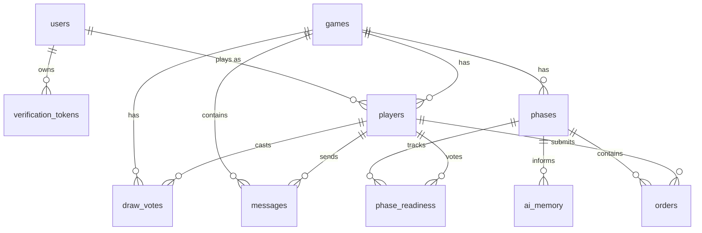

### Table purposes

| Table                 | Purpose                                                                             | Notes                                                                                                                                                                                                                                                                                                                                                                                                                                                |
| --------------------- | ----------------------------------------------------------------------------------- | ---------------------------------------------------------------------------------------------------------------------------------------------------------------------------------------------------------------------------------------------------------------------------------------------------------------------------------------------------------------------------------------------------------------------------------------------------- |
| `users` | Single identity row, auth credentials + public profile | `password_hash` nullable (OAuth users); `email_verified_at TIMESTAMPTZ NULL` — row is inserted at `/auth/register` but gated by the verification flow before login (Pattern B). `(oauth_provider, oauth_subject)` UNIQUE when non-null. For Microsoft: `oauth_subject = "{tid}:{oid}"` (NOT the OIDC `sub`, which is pairwise-per-app and documented as non-portable). Future profile fields (`display_name`, `avatar_url`, `rank`, `wins`, `losses`, `bio`) live on this row directly — no separate profile table. Matches webDip / Discord / GitHub single-table pattern. |
| `verification_tokens` | Unified short-lived codes for email-verify + password-reset                         | NextAuth-style. One row per issued code with `purpose ∈ {email_verify, password_reset}`, `token_hash` (SHA-256), `expires_at`, `used_at`. New codes invalidate prior outstanding codes for the same `(user_id, purpose)`. Deleted on user deletion via `ON DELETE CASCADE`. TTL: 15 min (`VERIFICATION_CODE_TTL_MINUTES`).                                                                                                                           |
| `games` | Game instances with lifecycle metadata | `status` ∈ `forming / active / finished / abandoned`. `movement_deadline_seconds INT NOT NULL DEFAULT 86400`; retreat and build deadlines computed as `movement_deadline_seconds / 2`. |
| `players` | **(planned)** Many-to-many join between `users` and `games`; captures role (power), AI status, AFK counter | `user_id` FK to `users.id` (NULL for AI slots). `power` randomly assigned at start. `afk_counter INT NOT NULL DEFAULT 0` increments on phase resolve if the human submitted no orders and wasn't ready, resets to 0 on any order submission. `locked BOOLEAN NOT NULL DEFAULT false` (one-way) when `afk_counter` hits 3; locked powers have defaults auto-applied for the remaining game. |
| `phases`              | Game clock: one row per phase, with board snapshot JSON                             | `phase_type` ∈ `movement / retreat / build`. `deadline_at TIMESTAMPTZ NOT NULL` captures the phase's absolute deadline (used by the un-ready-during-grace path to re-arm the original deadline rather than resetting it). `scheduler_gen INT NOT NULL DEFAULT 0` is incremented on every re-enqueue of deadline/grace jobs; encoded in jobId and payload so BullMQ dedup doesn't swallow re-enqueues when the prior job is still `active` (see §10). |
| `orders`              | Per-unit orders per phase; adjudicator fills `result` post-resolution               | Many per phase                                                                                                                                                                                                                                                                                                                                                                                                                                       |
| `phase_readiness`     | Per-player per-phase ready + skip-grace votes                                       | Row absent = not ready; reset each phase                                                                                                                                                                                                                                                                                                                                                                                                             |
| `draw_votes`          | DIAS draw vote tracking per player per game                                         | All survivors with row = draw                                                                                                                                                                                                                                                                                                                                                                                                                        |
| `ai_memory`           | AI's persistent strategic notes (alliances, promises, grudges)                      | Isolated per `(game_id, power)`. Server-side only; never served via any API — see §15 AI memory privacy.                                                                                                                                                                                                                                                                                                                                             |
| `messages`            | Chat (public or private 1:1)                                                        | `to_player_id` NULL = public                                                                                                                                                                                                                                                                                                                                                                                                                         |
| `session`             | Managed by `connect-pg-simple`; cookie-based sessions                               | We don't write SQL against it                                                                                                                                                                                                                                                                                                                                                                                                                        |

Schema defined in TypeScript at `packages/db/src/schema.ts` (Drizzle ORM) — single source of truth. Migrations auto-generated by `drizzle-kit generate` from schema diffs (dev runs locally, commits both the schema change and the resulting SQL file to `packages/db/migrations/`, reviewer approves both in the PR). Migrations run from a dedicated GH Actions step before each ACA deploy (`pnpm --filter @diplomacy/db migrate`), against Neon's direct (non-pooled) connection URL. pgBouncer transaction-mode would break the advisory locks and transactional DDL that migrations rely on. The migrate step also creates a Neon branch `pre-migration-{commit-sha-short}` before applying, and on failure the pipeline promotes that branch back to primary (see §15 Data loss / corruption). Backend and worker both import `{ db, games, phases, ... }` from `@diplomacy/db` and query via Drizzle's typed builder (`db.select().from(games).where(eq(games.id, id))`); the TS compiler catches schema/query drift at build time across the whole monorepo.

---

## 8. API Design

OpenAPI 3.1 contract-first. Spec lives at `packages/contracts/api/public/openapi.yaml`. All endpoints validated at runtime (request + response) by `express-openapi-validator`. The validator is mounted on `/api` only; the Socket.IO handshake path `/socket.io/` and health endpoints are intentionally outside its scope. Spec paths use OpenAPI path-template syntax and are mount-relative (e.g., `/games/{id}` in the spec → `/api/games/123` on the wire). The Kubb-generated client sets its baseURL to `/api` to match.

### Endpoint summary

Status legend: no tag = built; **(planned)** = reserved in spec but not implemented yet.

| Group        | Method | Path                                    | Purpose                                                                                                      |
| ------------ | ------ | --------------------------------------- | ------------------------------------------------------------------------------------------------------------ |
| Auth         | POST   | `/auth/register`                        | Begin password registration: inserts unverified user row, issues `email_verify` code, 202 (enumeration-safe) |
| Auth         | POST   | `/auth/register/verify`                 | Confirm the 6-digit code, mark `email_verified_at`, establish session                                        |
| Auth         | POST   | `/auth/register/resend`                 | Reissue the `email_verify` code for an unverified identifier (202, enumeration-safe)                         |
| Auth         | POST   | `/auth/password-reset`                  | Issue a `password_reset` code for a verified user with a password (202, enumeration-safe)                    |
| Auth         | POST   | `/auth/password-reset/verify`           | Confirm code + set new password hash + establish session                                                     |
| Auth         | POST   | `/auth/login`                           | Password login (identifier = email OR username)                                                              |
| Auth         | POST   | `/auth/logout`                          | Clear session                                                                                                |
| Auth         | GET    | `/auth/me`                              | Current user                                                                                                 |
| Auth (OAuth) | POST   | `/auth/oauth/microsoft/login`           | **(planned)** Returns OIDC auth URL                                                                          |
| Auth (OAuth) | GET    | `/auth/oauth/microsoft/callback`        | **(planned)** Code exchange + session start                                                                  |
| Games        | GET    | `/games`                                | List games (lobby)                                                                                           |
| Games        | POST   | `/games`                                | Create game                                                                                                  |
| Games        | GET    | `/games/:id`                            | Get game detail                                                                                              |
| Games        | POST   | `/games/:id/join`                       | Join (by code or open slot)                                                                                  |
| Games        | POST   | `/games/:id/start`                      | Creator starts early with AI fill                                                                            |
| Games        | POST   | `/games/:id/draw-vote`                  | Toggle draw vote                                                                                             |
| Games        | DELETE | `/games/:id/draw-vote`                  | Remove draw vote                                                                                             |
| Phases       | GET    | `/games/:id/phases/current`             | Current phase state                                                                                          |
| Phases       | POST   | `/games/:id/phases/current/resolve-now` | Dev-only manual resolve                                                                                      |
| Orders       | GET    | `/games/:id/phases/current/orders`      | List own orders                                                                                              |
| Orders       | PUT    | `/games/:id/phases/current/orders`      | Submit/update orders                                                                                         |
| Ready        | POST   | `/games/:id/phases/current/ready`       | Mark ready                                                                                                   |
| Ready        | DELETE | `/games/:id/phases/current/ready`       | Un-ready                                                                                                     |
| Ready        | POST   | `/games/:id/phases/current/skip-grace`  | Vote skip-grace                                                                                              |
| Messages     | GET    | `/games/:id/messages`                   | List messages                                                                                                |
| Messages     | POST   | `/games/:id/messages`                   | Send message                                                                                                 |

All rows above Auth (OAuth) and below `/auth/logout` are **(planned)** — the shape is reserved in the design but not yet in `openapi.yaml`.

**OAuth transient state:** `state`, `nonce`, and the PKCE `code_verifier` persist on `req.session` between `/login` and `/callback` (openid-client canonical idiom). `connect-pg-simple` writes a pre-auth session row; `pruneSessionInterval` cleans the orphans.

### Socket.IO events

Not covered by OpenAPI. Typed via hand-written TS in `packages/contracts/src/sockets/events.ts`:

- `phase:resolved`, payload includes new board state + resolution results
- `ready:changed`, N/M counter update
- `skip-grace:changed`, N/M counter update
- `message:new`, new chat message
- `cd:changed`, civil disorder status change; payload includes `player_id`, current `afk_counter`, and `locked` flag
- `game:ended`, game concluded (with reason)

---

## 9. Game Lifecycle State Machine

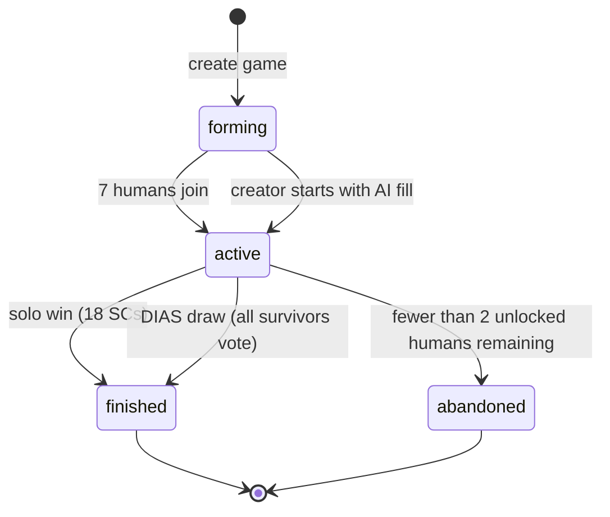

**Status transitions written by:**

- `forming → active`: `/games/:id/start` endpoint or auto-trigger when 7th human joins
- `active → finished`: worker after Winter/Build phase (solo detection) or on draw-vote update
- `active → abandoned`: worker after resolving a phase in which the last human player's `afk_counter` hit 3 and was flipped to `locked = true`. Condition: `COUNT(*) FROM players WHERE game_id = $1 AND user_id IS NOT NULL AND locked = false < 2`. A single dropped human never kills the game — teammates can play on with AI opponents; only when fewer than 2 humans remain unlocked does the game clean itself up.

---

## 10. Phase Resolution Flow

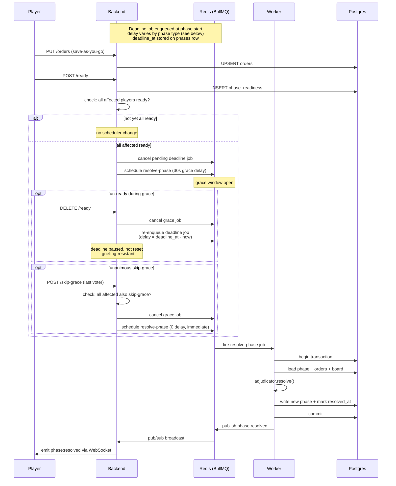

**Idempotency guard (correctness, not optimization):**

BullMQ guarantees "at least once" delivery; a job can run after `queue.remove()` fails (job already `active`), so the handler cannot assume one-shot execution _or_ trigger freshness. The job payload carries `{ phaseId, trigger: 'grace' | 'immediate' | 'deadline', gen }`. On entry:

```sql
BEGIN;
SELECT resolved_at, deadline_at, scheduler_gen FROM phases WHERE id = $1 FOR UPDATE;

-- If resolved_at IS NOT NULL → commit no-op.
-- If payload.gen != scheduler_gen → commit no-op (stale, superseded by re-arm).
-- Else re-derive the trigger's current validity:
--   trigger = 'grace'     → recompute all-affected-ready; if false, no-op (stale).
--   trigger = 'immediate' → recompute all-affected skip-grace; if false, no-op.
--   trigger = 'deadline'  → require NOW() >= deadline_at; else no-op.
-- Otherwise resolve and write resolved_at = NOW().
```

The row lock serializes concurrent workers; the trigger-freshness check prevents a stale grace or deadline from resolving against invalidated state. `queue.remove()` calls remain best-effort optimizations.

**Scheduler generation on jobIds**: `deadline-${phaseId}-${gen}` and `grace-${phaseId}-${gen}`. Each cancel/re-enqueue bumps `phases.scheduler_gen` so BullMQ dedup can't swallow the re-arm when the old job is still `active`. Handler validates `payload.gen === phases.scheduler_gen` alongside the trigger-freshness check; stale `gen` → no-op.

**Deadline computation (per phase type):**

All seconds values below are multiplied by 1000 at the BullMQ queue boundary (`delay` is milliseconds).

- **Movement** phases: `games.movement_deadline_seconds` (default 86400 → `delay: 86_400_000`).
- **Retreat** phases: `movement_deadline_seconds / 2`.
- **Build** phases: `movement_deadline_seconds / 2`.
- Grace job: 30 seconds → `delay: 30_000`.
- Re-armed deadline (un-ready-during-grace): `(deadline_at - now)` seconds → × 1000.

The backend persists the absolute `deadline_at` on the `phases` row so the un-ready-during-grace branch (above) can re-arm the original deadline instead of resetting it.

**Resolution triggers (in priority order):**

1. **Unanimous skip-grace** → immediate
2. **All affected ready + 30s grace elapsed** → scheduled
3. **Deadline reached** → fallback. Backend applies per-phase-type defaults _before_ invoking the adjudicator so the adjudicator always sees a complete order set:
   - **Movement**: missing orders → Hold
   - **Retreat**: missing retreats → Disband (dislodged unit disbanded)
   - **Build**: missing order with positive build delta → **waive** (no unit added); missing order with negative delta → auto-disband farthest-from-home (Avalon Hill convention). A power never loses units from a positive delta.

**Auto-skip empty phases:**

When a prior phase resolves and the backend chooses the next phase to create:

- Next-is-Retreat → check if any power has a dislodged unit. If none → **skip entirely** (no phase row created, no deadline job, advance directly to the next Movement).
- Next-is-Build → check if any power has an SC-count/unit-count delta. If none → **skip entirely**, advance.

Only decision-bearing phases exist in Postgres. Players never see a 24h-stale UI for a phase with no decisions.

**"Affected players" per phase type:**

- Movement: all surviving powers (every power with ≥1 unit)
- Retreat: only powers with dislodged units
- Build: only powers with a build/disband delta

The all-affected-ready check in the sequence above is per-phase-type by this definition. AI powers are always treated as instantly ready for grace purposes (they submit orders programmatically and set phase_readiness Ready + Skip-grace in the same transaction).

---

## 11. AI Turn Flow

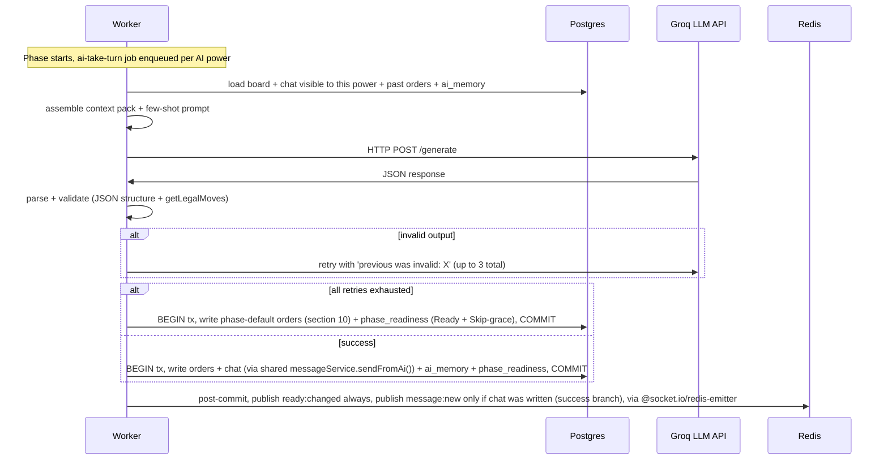

**Why stateless workers + stateful DB**: the AI's memory lives entirely in Postgres (chat log, past orders, `ai_memory`). No in-memory agent, no per-game process. Scales trivially via BullMQ worker replicas.

**Scheduler + idempotency**: after commit, worker invokes the shared scheduler service (same path humans use) so AI-last-ready triggers grace instead of waiting the full deadline. JobId is `ai-take-turn-${gameId}-${power}-${phaseId}` — no `gen` suffix since AI jobs are one-shot per `(game, power, phase)`. Handler enters with `SELECT 1 FROM phases WHERE id = $1 AND resolved_at IS NULL FOR UPDATE` plus a `SELECT 1 FROM orders WHERE phase_id = $1 AND power = $2 FOR UPDATE`; if the phase is resolved OR orders already exist, no-op. Covers stalled-job replay and prevents writing into an already-resolved phase.

---

## 12. Realtime Communication

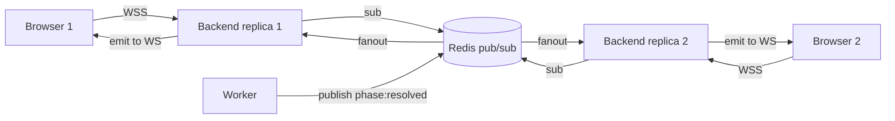

**Socket.IO rooms:**

- `game:<id>`, all players in a game (public events + public chat)
- `game:<id>:player:<player_id>`, single player (private DMs addressed to them)

**Auth**: HTTP session cookie flows into the WS handshake via `io.engine.use(sessionMiddleware)`. One auth system end-to-end. The frontend and backend run on **subdomains of a single apex domain** (`app.<apex>` and `api.<apex>`), so the session cookie is set on `.<apex>` with `SameSite=Lax` instead of the permissive `SameSite=None`. Browser enforces same-site semantics at the request layer, which blocks the vast majority of CSRF and CSWSH attempts before they ever reach the backend. As defense-in-depth, Socket.IO is still configured with an explicit `allowRequest` handler that validates the `Origin` header against the known frontend origins per env, rejecting unknown origins with HTTP 403 before the upgrade completes. The same allowlist is used by the REST CORS config so there is one source of truth.

**Transport**: WebSocket only (no polling fallback). Avoids sticky load balancing requirements.

**Reconnect state recovery**: Socket.IO's auto-reconnect only re-establishes the connection; it does not replay events that fired during the dead window. On successful reconnect, the client calls `queryClient.invalidateQueries(['game', id])` which triggers a TanStack Query refetch of the current phase + board + messages via REST. This brings the client back to the authoritative server state before any new WS events arrive. The server does not maintain a per-client event log, so there is no replay channel to subscribe to, the authoritative state is always Postgres, surfaced via GET.

**Reconnection**: client retries 10 times with exponential backoff; surfaces a sonner toast on exhaustion.

**Cross-process event emission**: worker uses `@socket.io/redis-emitter` (emit-only, no engine state); backend's `@socket.io/redis-adapter` on the real `Server` delivers each emit only to sockets in the targeted room. Every worker emit names its target: `phase:resolved`, `cd:changed`, `game:ended` → `game:<id>`; `message:new` → `game:<id>` for public, `game:<id>:player:<to_player_id>` for DMs. Nothing emits globally. Emitter and adapter must share a major version. **Room joins are authorized server-side**: on connection, backend verifies the session's user is a `players` row for that game before `socket.join('game:<id>')`, and only joins `game:<id>:player:<own_id>` for the authenticated user's own seat.

**Local development**: Vite dev server proxies `/api/*` and `/socket.io/*` (`ws: true`) to Express via `server.proxy`, with `changeOrigin: true` and `Origin` stripped on `/api` so dev looks same-origin like prod. SameSite=Lax and session cookies work identically in both. `PROXY_API_TARGET` overrides the backend target.

---

## 13. CI/CD Pipeline

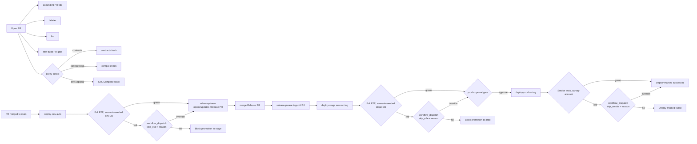

**Workflow trigger table:**

| Workflow                    | Trigger                                                  | Purpose                                                                                                                                                                                                                                                                                                                             |
| --------------------------- | -------------------------------------------------------- | ----------------------------------------------------------------------------------------------------------------------------------------------------------------------------------------------------------------------------------------------------------------------------------------------------------------------------------- |
| `commitlint.yml`            | PR open/sync                                             | Lints PR title against conventional-commit format. Required check.                                                                                                                                                                                                                                                                  |
| `labeler.yml`               | PR open/sync                                             | Auto-adds `area:*` labels based on changed paths.                                                                                                                                                                                                                                                                                   |
| `lint.yml`                  | PR open/sync                                             | ESLint + Prettier + typecheck. Always runs.                                                                                                                                                                                                                                                                                         |
| `test-build.yml`            | PR open/sync                                             | Full build + unit tests + E2E against Compose stack. Uses `environment: dev` for secret scope but does NOT deploy. Acts as the deployability check.                                                                                                                                                                                 |
| `contract-check.yml`        | PR open/sync (if `packages/contracts/**` changed)        | Regen contracts (generated code is gitignored), assert `tsc` passes on the regenerated output.                                                                                                                                                                                                                                      |
| `compat-check.yml`          | PR open/sync (if `packages/contracts/api/**` changed)    | oasdiff vs base branch. Fails on breaking changes without `breaking-change-approved` label.                                                                                                                                                                                                                                         |
| `e2e.yml` | PR open/sync (if any `apps/**` or `packages/**` changed) | Playwright E2E + Postman contract tests against a Compose stack with `MOCK_AI=true` (MSW intercepts the Groq HTTPS endpoint; fixtures at `apps/worker/test/fixtures/llm/*.json`). Covers prompt assembly, parse, legal-move validation, retry loop, and phase-default fallback (per phase type: Hold / Disband / auto-disband). |
| `ai-smoke.yml` | `workflow_dispatch` only | Runs real Groq API against a Compose stack using a shared team key (separate from per-dev keys). Exercises 2-3 AI turns in a real game, asserts legal orders submitted (not quality — matches §18 acceptance threshold). WS-5 runs before significant AI changes land. Not a PR gate. |
| `migrate.yml`               | reusable (`workflow_call`)                               | Creates a Neon branch `pre-migration-{commit-sha-short}`, runs `pnpm --filter @diplomacy/db migrate` (drizzle-kit) against Neon's direct (non-pooled) connection. On failure, promotes the branch back to primary. Called by `deploy-dev.yml` / `deploy-stage.yml` / `deploy-prod.yml` before their ACA deploy step.                |
| `deploy-dev.yml` | `push: branches: [main]` | Calls `migrate.yml` then auto-deploys backend + worker to dev ACA env on PR merge. Chains into `e2e-dev.yml` on success. |
| `deploy-frontend-dev.yml` | `push: branches: [main]` | Builds and uploads the SPA static artifact to the dev Azure Static Web App on PR merge. |
| `e2e-dev.yml` | `workflow_run` after `deploy-dev.yml` + `deploy-frontend-dev.yml` | Runs `pnpm seed:scenario e2e-*` against the dev DB, then the full Playwright suite against the deployed dev env. Red here blocks `release-please.yml` from opening or updating the Release PR. |
| `release-please.yml` | `push: branches: [main]` + green `e2e-dev.yml`; also `workflow_dispatch` with `skip_e2e` + `reason` for break-glass | Updates the Release PR with CHANGELOG + version bump based on conventional-commit types since last release. Gated on the dev E2E pass so we never tag a release from a red dev. Override path records reason in run log; see break-glass block below. |
| `deploy-stage.yml` | `push: tags: ['v*']` | Calls `migrate.yml` then auto-deploys to stage ACA env when release-please creates a tag. Chains into `e2e-stage.yml` on success. |
| `deploy-frontend-stage.yml` | `push: tags: ['v*']` | Uploads the SPA static artifact to the stage Azure Static Web App on tag. |
| `e2e-stage.yml` | `workflow_run` after `deploy-stage.yml` + `deploy-frontend-stage.yml` | Same shape as `e2e-dev.yml` against the stage DB + deployed stage env. Red here blocks the prod approval gate on the same tag. |
| `deploy-prod.yml` | `push: tags: ['v*']` + reviewer approval + green `e2e-stage.yml`; also `workflow_dispatch` with `skip_e2e` + `reason` for break-glass | Calls `migrate.yml` then deploys to prod ACA env. Chains into `smoke-prod.yml` on success. Reviewer approval still required even on override. |
| `deploy-frontend-prod.yml` | `push: tags: ['v*']` | Uploads the SPA static artifact to the prod Azure Static Web App. Same `prod` GH environment approval gate as `deploy-prod.yml`. |
| `smoke-prod.yml` | `workflow_run` after `deploy-prod.yml` + `deploy-frontend-prod.yml`; also `workflow_dispatch` with `skip_smoke` + `reason` for break-glass | Runs the 3-5 critical-path Playwright specs against the deployed prod env using the pre-provisioned canary account (`canary@diplomacy.gg`). Each spec follows create → assert → delete so artifacts don't accumulate. No seeding against the real prod DB. Red here marks the deploy failed; `skip_smoke` + reason overrides. |
| `discord-pr.yml`            | PR open                                                  | Existing Discord notification.                                                                                                                                                                                                                                                                                                      |

**Change detection via dorny/paths-filter**: conditional workflows still trigger on every PR (keeps branch protection happy) but gate their jobs with `if: needs.detect.outputs.X == 'true'`. A no-op workflow still reports success. Path patterns are repo-root-relative, so filters prefix the monorepo root: `ProjectSourceCode/apps/**` and `ProjectSourceCode/packages/**` (not bare `apps/**`).

### E2E in the promotion pipeline

Three tiers; each has a different purpose, so they use different suites and different test data strategies.

| Env       | When it runs                                   | Suite                                                 | Test data                                                               | Role                                                                                                             |
| --------- | ---------------------------------------------- | ----------------------------------------------------- | ----------------------------------------------------------------------- | ---------------------------------------------------------------------------------------------------------------- |
| **dev**   | After `deploy-dev.yml` on merge to main        | Full Playwright suite                                 | `pnpm seed:scenario e2e-*` against the dev DB (scenario-seeded, see §6) | Cheapest regression catcher. Gates promotion to stage.                                                           |
| **stage** | After `deploy-stage.yml` on tag                | Full Playwright suite                                 | Same scenario seeders against the stage DB                              | Last fully-isolated run. Catches deploy-shape bugs that dev's env didn't expose. Gates promotion to prod.        |
| **prod**  | After `deploy-prod.yml` on tag (post-approval) | **Smoke tests only** (handful of critical-path specs) | Pre-provisioned canary account; no seeding                              | Proves the deploy itself worked (containers up, DB reachable, auth intact). Blocks deploy-success marker if red. |

**Why prod is smoke-only, not the full suite.** Prod has real users and real data. A full E2E suite would create test games, fill chat logs, run up real Resend email quota, and pollute the state our users see. Stage is the last place we trust for _correctness_; prod E2E only asserts _deployability_. Industry default: GitLab, Stripe, and most ACA-style shops run narrow smoke tests + synthetic monitoring in prod, not the full suite.

**Smoke test shape.** 3-5 Playwright specs max. Each follows create → assert → delete so artifacts don't accumulate. The canary user is a fixed prod account (`canary@diplomacy.gg`) provisioned once by hand or a one-time migration; its credentials live in the `prod` GH environment secrets.

**Synthetic monitoring (post-MVP).** Same shape as prod smoke, run on a cron (every 5-15 min) with alerting. Deferred: Checkly, Datadog Synthetics, or a GH Actions cron hitting Playwright. Only worth adding if we want continuous uptime signal between deploys.

### Break-glass override for E2E gates

E2E suites fail for two reasons: the code under test is wrong, or the test itself is wrong. The default gate (block promotion) is right for the first case and wrong for the second. We also need an escape hatch for genuinely urgent hotfixes where the suite can't finish in time.

Each promotion-gated workflow (`release-please.yml`, `deploy-prod.yml`, the `-success` markers after `smoke-prod.yml`) accepts a `workflow_dispatch` trigger with two inputs:

- `skip_e2e` / `skip_smoke`: boolean, defaults false
- `reason`: string, **required**, ≥20 chars (enforced via `if: inputs.reason != '' && length(inputs.reason) >= 20`)

When invoked with `skip_e2e: true`, the workflow's E2E-gate step short-circuits and the downstream step runs. The reason is echoed into the workflow log at the start of the run and attached to the deployment record (via `gh deployment create --payload '{"override_reason":"..."}'`).

**Guardrails that stay in force even on override:**

- The `prod` GH Environment's required reviewers still apply. A single person cannot push broken code to prod via override alone — someone else still has to click approve on the deploy.
- `compat-check` (OpenAPI breaking changes) is independent of E2E; override does not bypass it.
- Migrations (`migrate.yml`) still run; override does not skip schema changes.

**Audit trail.** Each override is discoverable via the standard GH Actions UI (`workflow_dispatch` runs are visually distinct from `push` runs) and the `reason` is the first line of the run summary. Teammates can grep for these in the Actions tab to review recent break-glass use.

**When to use it.** Narrow list:

- Test infrastructure is flaky and we've opened a tracking issue to fix it.
- Urgent hotfix (data corruption, auth bypass, outage) where the full suite's duration is unacceptable.
- The E2E suite itself is being updated and is temporarily red while the new scenario seeder lands.

**When NOT to use it.** Anything that smells like "the test caught a real bug and I'm tired of it." The entire point of the gate is that case; if it feels tempting there, the right move is to fix the code and re-run.

**Dependency propagation**: changing `packages/contracts/**` triggers backend AND frontend AND worker tests. Changing `packages/game-types/**` or `packages/adjudicator/**` triggers all consumers.

**release-please + conventional commits:**

- Commit messages and PR titles follow conventional format (`feat:`, `fix:`, `chore:`, `docs:`, `test:`, `refactor:`, `BREAKING CHANGE:` or `feat!:`).
- `commitlint.yml` enforces this on PR titles via `amannn/action-semantic-pull-request`.
- release-please accumulates merged PRs into a growing "Release PR" that describes the next release.
- Merging the Release PR creates the `v*` tag + GitHub Release, which triggers stage + prod deploys.
- Monorepo config: single root version (everything moves together). Independently versioned apps possible later.

**Deploy strategy summary:**

- **PR**: no cloud deploy. `test-build.yml` runs a full build + test with dev-env secret scope as the deployability check.
- **PR merge → main**: `deploy-dev.yml` ships `main` to the shared dev ACA env. Dev always reflects HEAD of main.
- **Release PR merge**: release-please creates the tag → stage deploys automatically → prod waits for human approval, then deploys.

---

## 14. Tech Stack Decisions

For each decision below, the **recommended** choice is what we plan to implement. The **next-best** alternative is a legitimate direction we considered, team members should raise objections before M2 if they prefer the alternative.

| Decision                     | Recommended                                                                 | Pros                                                                                                                                                                                                              | Cons                                                                            | Next-best                                        | Alt pros                                                         | Alt cons                                                                    |
| ---------------------------- | --------------------------------------------------------------------------- | ----------------------------------------------------------------------------------------------------------------------------------------------------------------------------------------------------------------- | ------------------------------------------------------------------------------- | ------------------------------------------------ | ---------------------------------------------------------------- | --------------------------------------------------------------------------- |
| Language                     | **TypeScript everywhere**                                                   | Compile-time safety across monorepo; Kubb hooks + OpenAPI types fully leveraged                                                                                                                                   | Build step; some teammate ramp-up                                               | Plain JavaScript                                 | Zero build; matches labs                                         | Loses most of OpenAPI/Kubb value; adjudicator correctness relies on runtime |
| HTTP framework               | **Express 5**                                                               | Lab-aligned; native async + rejection handling built in                                                                                                                                                           | Older design than Fastify                                                       | Fastify                                          | 2-5x faster; built-in JSON schema validation                     | Different ecosystem; team ramp-up                                           |
| DB client                    | **Drizzle ORM**                                                             | Typed queries; schema-in-TS as single source of truth; auto-generated migrations                                                                                                                                  | Learning curve vs Lab 7's pg-promise                                            | pg-promise                                       | Lab standard; direct SQL                                         | No typed queries; hand-written migrations scale poorly                      |
| OpenAPI validation           | **express-openapi-validator**                                               | Spec is source of truth; enforced at request + response time                                                                                                                                                      | Reflection overhead; opaque deep-schema errors                                  | Zod schemas → generate OpenAPI                   | Code as truth; best TS inference                                 | Inverts contract-first; loses human-authored spec                           |
| Session store                | **connect-pg-simple**                                                       | Postgres already present; durable                                                                                                                                                                                 | 1 SELECT per authenticated request                                              | connect-redis                                    | Sub-ms lookups                                                   | Durability depends on Redis AOF                                             |
| Password hashing             | **`crypto.scrypt` (Node native)**                                           | Zero dependencies; memory-hard; OWASP-approved tier                                                                                                                                                               | Slightly less modern than argon2                                                | argon2                                           | Current best-in-class; GPU-resistant                             | Native compile; node-gyp pain in Alpine                                     |
| OAuth library                | **openid-client**                                                           | Generic OIDC; swap-in Google/GitHub later                                                                                                                                                                         | Not Microsoft-specific                                                          | @azure/msal-node                                 | Official Microsoft support                                       | Azure-specific lock-in                                                      |
| Transactional email          | **Resend**                                                                  | Simple API; free tier covers dev + demo volume; works via a single `RESEND_API_KEY`. Logging fallback when the key is unset so local dev doesn't need a real inbox: email body + verify URL print to backend logs | Resend-specific; vendor lock                                                    | AWS SES                                          | Cheap at scale; broad deliverability                             | Per-env SPF/DKIM/DMARC setup; new SES accounts land in sandbox mode         |
| Rate limiting (local)        | **express-rate-limit + MemoryStore**                                        | Zero infra for local dev; per-IP per-route windows                                                                                                                                                                | In-process only; useless across replicas                                        | —                                                | —                                                                | —                                                                           |
| Rate limiting (cloud)        | **express-rate-limit + `rate-limit-redis` on Upstash**                      | Shared across ACA replicas; survives restarts                                                                                                                                                                     | One more service dep                                                            | Postgres-backed limiter                          | Uses existing DB                                                 | ~5-10× slower than Redis at hot paths                                       |
| Logger                       | **pino**                                                                    | Fast, JSON-structured, request-scoped child loggers                                                                                                                                                               | Terminal readability needs pino-pretty                                          | winston                                          | More transport plugins                                           | Slower; more config                                                         |
| Error handling               | **Central middleware + plain `throw`**                                      | Simple; Express 5 native async rejection                                                                                                                                                                          | none                                                                            | RFC 7807 Problem Details                         | Standardized error shape                                         | More boilerplate                                                            |
| Realtime                     | **Socket.IO + Redis adapter (backend) + @socket.io/redis-emitter (worker)** | Cross-replica broadcast; one auth system                                                                                                                                                                          | WS-only transport; emitter and adapter must share major version                 | Server-Sent Events (SSE)                         | Simpler; HTTP-only                                               | One-way                                                                     |
| Routing (frontend)           | **React Router v7**                                                         | Dominant; team-familiar; rich ecosystem                                                                                                                                                                           | Larger API surface                                                              | TanStack Router                                  | Type-safe routes natively                                        | Smaller community; different mental model                                   |
| Server state                 | **TanStack Query (via Kubb)**                                               | Industry standard; caching + mutations + invalidation                                                                                                                                                             | none                                                                            | SWR                                              | Smaller API                                                      | Less feature complete                                                       |
| Client state                 | **Zustand**                                                                 | Minimal; atoms-based; tiny API                                                                                                                                                                                    | none significant                                                                | Jotai                                            | Pure atoms model                                                 | Similar niche; smaller community                                            |
| Styling                      | **Tailwind**                                                                | Utility-first; works great with Shadcn                                                                                                                                                                            | Utility-class noise in JSX                                                      | CSS Modules                                      | Scoped styles; conventional CSS                                  | More files; no shared design tokens by default                              |
| Component library            | **shadcn/ui on Base UI**                                                    | Own-the-code; unopinionated; accessible. shadcn migrated from Radix to Base UI in late 2025, so trigger APIs differ (no `asChild` on Trigger, no `onSelect` on Item — use `onClick`, style trigger directly)      | Diverges from most shadcn-era tutorials                                         | shadcn on Radix (older setup)                    | Lots of community examples                                       | Deprecated upstream; would need backport work                               |
| Board rendering              | **Import existing Diplomacy SVG + event delegation**                        | Fast to ship; art already correct                                                                                                                                                                                 | DOM-handler style less React-idiomatic                                          | Hand-render each `<Province>` as React component | Fully React-idiomatic; props-driven                              | More upfront work                                                           |
| Forms                        | **React Hook Form**                                                         | Dominant; performant; Zod/Yup validation                                                                                                                                                                          | One more dep                                                                    | TanStack Form                                    | Type-safe; matches other TanStack picks                          | Smaller community                                                           |
| Date/time                    | **date-fns**                                                                | Modular; tree-shakeable; functional                                                                                                                                                                               | Functional API unfamiliar to Moment users                                       | dayjs                                            | Moment-compatible chaining; 2KB                                  | Plugin-based for extras                                                     |
| Icons                        | **lucide-react**                                                            | 1,400+ icons; Shadcn default                                                                                                                                                                                      | none                                                                            | Heroicons                                        | Official Tailwind pairing                                        | Smaller set                                                                 |
| Toasts                       | **sonner**                                                                  | Modern; 5KB; works with Tailwind                                                                                                                                                                                  | Newer, slightly less flexible                                                   | react-hot-toast                                  | Battle-tested                                                    | Dated styling defaults                                                      |
| Queue library                | **BullMQ**                                                                  | TS-native; cancellation by ID (needed for grace); de-facto Node standard                                                                                                                                          | Needs Redis                                                                     | pg-boss                                          | Postgres-only; one fewer service                                 | Smaller community; less feature-complete                                    |
| Postgres version             | **16**                                                                      | Supported through 2028; better perf defaults than 14 (LZ4 TOAST, `pg_stat_io`); well-covered by Neon and tooling                                                                                                  | Not the newest (18 is current as of 2025); minor divergence from lab image 14   | 14 (lab default)                                 | Matches labs exactly                                             | Missing LZ4 TOAST, older JSON path, dated defaults                          |
| Migration tool               | **drizzle-kit**                                                             | Auto-generates SQL from schema diffs; Node-native                                                                                                                                                                 | Tied to Drizzle                                                                 | node-pg-migrate                                  | Works without an ORM                                             | Hand-written SQL only                                                       |
| Pooling                      | **node-postgres + pgBouncer** (via Drizzle's `pg` adapter)                  | Scales replicas without exhausting max_connections                                                                                                                                                                | Transaction-mode quirks; migrations need Neon's direct URL                      | `node-postgres` built-in pool                    | Zero extra infra                                                 | Can exhaust max_connections at scale                                        |
| Mock servers                 | **Postman (dev) + MSW (frontend tests)**                                    | Both worlds: shared team mock URL + in-browser test mocks                                                                                                                                                         | Two mock sources to maintain                                                    | Postman only                                     | One source                                                       | Loses frontend-test mocking without HTTP                                    |
| Monorepo                     | **pnpm workspaces**                                                         | Fast installs, strict hoisting (prevents phantom deps), first-class monorepo support, works great with Turborepo later if needed                                                                                  | One more tool to install locally; diverges slightly from the labs' npm defaults | npm workspaces                                   | Lab-aligned; zero new tool to install                            | Slower installs; looser hoisting lets phantom deps slip in                  |
| Monorepo task runner         | **Make + pnpm scripts**                                                     | Universal; no new DSL; `pnpm -r` fans out across workspaces                                                                                                                                                       | Verbose per-target scripts                                                      | Turborepo                                        | Build caching; task orchestration                                | New tool; config overhead                                                   |
| Compose organization         | **Single docker-compose.yaml**                                              | Simplest                                                                                                                                                                                                          | Dev tweaks mix with service def                                                 | Base + override files                            | Clean prod-like split                                            | Two files to understand                                                     |
| Node base image              | **node:24-alpine**                                                          | LTS through April 2028 (longest window); newer V8; built-in WebSocket client; explicit resource management (`using` keyword helps with pg connection pools); smaller than Debian-slim                             | musl can break some native deps (not an issue for our pure-JS stack)            | node:22-alpine                                   | Previous LTS (through April 2027); deeper Stack Overflow backlog | Shorter support window; older V8                                            |
| Secrets handling             | **.env per app locally; GH env secrets in cloud**                           | Lab convention; built-in approval gates                                                                                                                                                                           | none                                                                            | Doppler free tier                                | Cloud secret manager; audit log                                  | New signup; cloud dep                                                       |
| CI structure                 | **Flat per-concern workflows**                                              | Easy to grep; one file per concern                                                                                                                                                                                | Setup duplication across workflows                                              | Reusable via workflow_call                       | DRY; shared steps across workflows                               | Indirection; more files                                                     |
| Change detection             | **Labeler + dorny/paths-filter**                                            | GH-native; branch protection stays happy                                                                                                                                                                          | More per-workflow config                                                        | Trigger-level path filters                       | Simpler config                                                   | Breaks branch protection on required skipped checks                         |
| Deploy target | **Azure Container Apps + Neon + Upstash** | KEDA queue scaling; free tier covers dev/stage/prod for our app shape (no pinned-replica LLM container — LLM is hosted externally by Groq) | Azure lock-in | AWS ECS Fargate + RDS + ElastiCache | Larger ecosystem | No scale-to-zero; weaker free tier |
| Frontend hosting             | **Azure Static Web Apps per env**                                           | Free tier covers 3 envs; managed SSL for apex subdomains; matches CP's static-artifact pattern                                                                                                                    | SWA-specific config; no PR previews                                             | Azure Blob + Front Door                          | More control                                                     | More setup; no previews                                                     |
| AI runtime | **Groq cloud API** | Free tier covers full project volume with 20×+ headroom; ~300ms/turn (fastest hosted llama); zero infra; portable prompts (any llama host works) | Network dep (mitigated by §18 portability — swap host, keep prompts); per-dev API key required for real-AI path (mocks cover rest of dev) | Google Gemini 3.5 Flash-Lite | Schema-enforced JSON retires parse retries; Google stability | Vendor lock on `responseSchema`; Gemini 2.5 just got a 3-week deprecation notice, model-family churn is a recurring risk |
| AI model | **`llama-3.1-8b-instant` (Groq-hosted)** | Same llama 3.1 8B we originally chose, just hosted; portable to Together / Fireworks / self-host if Groq blips | Startup-hosted; no SLA on free tier | `llama-3.3-70b-versatile` (Groq-hosted) | Stronger reasoning for mid-game decisions | Slower (~1s/turn); higher TPD impact on free tier |
| AI output format | **Prompt-requested JSON + 3 retries (Groq JSON mode)** | Works with Groq's `response_format: { type: "json_object" }`; portable to any llama host | Retries cost latency; 8B occasionally emits malformed JSON | Gemini `responseSchema` (if we switch to Gemini) | Server-side schema enforcement; zero malformed-JSON retries | Only works on Gemini; locks us in |
| Testing (all workspaces)     | **Vitest**                                                                  | One framework across the monorepo; modern TS support; browser mode via `@vitest/browser-playwright` for frontend                                                                                                  | Diverges from lab convention (lab uses Mocha+Chai)                              | Mocha + Chai                                     | Matches lab stack                                                | Older; split framework across repo                                          |
| E2E / integration (frontend) | **Playwright + MSW**                                                        | Vite-native; MSW works great for API mocking                                                                                                                                                                      | none significant                                                                | Cypress + Nock                                   | Older but still common                                           | Slower; dated                                                               |
| Test DB isolation            | **Per-test transaction + rollback**                                         | Fast; isolated; no cleanup bugs                                                                                                                                                                                   | Can't use nested transactions in tests                                          | Per-test fresh schema                            | Allows nested txns                                               | Slower per test                                                             |
| DATC organization            | **One file per section (~9 files)**                                         | Manageable; maps to milestone progress                                                                                                                                                                            | Files grow to 15+ cases each                                                    | One file per case (~60+ files)                   | Atomic PRs                                                       | Overwhelming directory                                                      |

### Decisions explicitly open to team pushback before M2

If anyone on the team has a strong preference for the alternative, flag it in a PR comment on this doc **before** M2 implementation begins (end of week 1):

- **Monorepo task runner**, Make vs Turborepo (simple vs faster builds)
- **DB client**, pg-promise vs Drizzle (lab vs TS-first)
- **Routing**, React Router vs TanStack Router (dominant vs type-safe)

Other decisions are more locked (e.g., Express 5 matches the lab stack directly; swapping is a day-of-sprint risk).

---

## 15. Security Considerations

| Concern                                 | Mitigation                                                                                                                                                                                                                                                                                                                                                                                                                                                                                                                                                                                                                                                                                                                                                                                                                                                                                                                                     |
| --------------------------------------- | ---------------------------------------------------------------------------------------------------------------------------------------------------------------------------------------------------------------------------------------------------------------------------------------------------------------------------------------------------------------------------------------------------------------------------------------------------------------------------------------------------------------------------------------------------------------------------------------------------------------------------------------------------------------------------------------------------------------------------------------------------------------------------------------------------------------------------------------------------------------------------------------------------------------------------------------------- |
| **SQL injection**                       | Drizzle query builder (`db.select().from(...).where(eq(...))`) parameterizes by construction; any raw escape hatch (`db.execute(sql`…`)`) uses tagged-template parameters, never string concatenation. express-openapi-validator rejects malformed input before it reaches handlers.                                                                                                                                                                                                                                                                                                                                                                                                                                                                                                                                                                                                                                                           |
| **Password storage**                    | Node native `crypto.scrypt` (N=16384, r=8, p=1, OWASP-recommended). Never log passwords.                                                                                                                                                                                                                                                                                                                                                                                                                                                                                                                                                                                                                                                                                                                                                                                                                                                       |
| **Session hijacking**                   | HTTP-only cookies; `SameSite=Lax; Secure` cookie scoped to `.<apex>` so frontend subdomain and api subdomain share one same-site context (HTTPS enforced in all envs). Sessions stored in Postgres (survives backend restarts).                                                                                                                                                                                                                                                                                                                                                                                                                                                                                                                                                                                                                                                                                                                |
| **XSS**                                 | React auto-escapes by default. No `dangerouslySetInnerHTML` on user input. Content Security Policy header via helmet.                                                                                                                                                                                                                                                                                                                                                                                                                                                                                                                                                                                                                                                                                                                                                                                                                          |
| **CSRF**                                | `SameSite=Lax` on the session cookie is the primary defense (browser enforced): the cookie is only sent on top-level navigations and same-site subresource requests. Defense-in-depth: strict `Origin` header check on both REST (CORS) and WebSocket (`allowRequest`) handshakes. CSRF tokens are optional given the SameSite=Lax baseline; we add them only if we introduce a cross-site workflow that requires `SameSite=None`.                                                                                                                                                                                                                                                                                                                                                                                                                                                                                                             |
| **Rate limiting**                       | `express-rate-limit`: MemoryStore locally, `rate-limit-redis` on Upstash in cloud (§14). Global 300 req/min per authenticated session + 30 req/min per IP for anonymous. Per-route IP windows on auth: register 5/hr, register-verify 10/15min, register-resend 3/min, password-reset 3/hr, password-reset-verify 10/15min. Login retains IP-based limits to blunt credential stuffing. Chat 30 msg/min per player per game.                                                                                                                                                                                                                                                                                                                                                                                                                                                                                                                   |
| **Email verification + password reset** | Pattern B: `/auth/register` inserts a user row with `email_verified_at NULL`, issues a 6-digit code (`crypto.randomInt`), stores its SHA-256 in `verification_tokens` with 15-min TTL, and returns a bare 202 (enumeration-safe). The frontend never learns whether the email was new, existing-unverified, or existing-verified; same shape for `/auth/register/resend` and `/auth/password-reset`. Re-registering an unverified account rehashes the newly-typed password before reissuing the code (so the user's latest input is what works post-verify). Verify endpoints confirm the code's hash against the stored row, mark it `used_at`, and establish the session via `req.session.regenerate()`. Password reset only issues codes for verified users with a password set (OAuth-only accounts silently no-op). Codes don't leak the account's state to timing: the slow path (bcrypt-scale scrypt) only runs after code validation. |
| **OAuth**                               | PKCE (recommended by current Microsoft guidance even for confidential clients) + state + nonce stored in `req.session`. On successful callback: `req.session.regenerate()` BEFORE assigning `req.session.user` (session-fixation defense, OWASP ASVS). Local logout only — `req.session.destroy()` + clear cookie; no RP-initiated logout (Microsoft SSO cookie lives on login.microsoftonline.com either way; shared-device scenario out of scope).                                                                                                                                                                                                                                                                                                                                                                                                                                                                                           |
| **Secrets**                             | Never committed. `.env` gitignored; cloud env values in GH environment secrets with reviewer gate on prod.                                                                                                                                                                                                                                                                                                                                                                                                                                                                                                                                                                                                                                                                                                                                                                                                                                     |
| **Dependency vulnerabilities**          | Dependabot alerts enabled. `pnpm audit` in CI.                                                                                                                                                                                                                                                                                                                                                                                                                                                                                                                                                                                                                                                                                                                                                                                                                                                                                                 |
| **AI prompt injection**                 | AI output validated structurally (JSON schema) and semantically (`getLegalMoves()`) before any DB write. AI can't inject arbitrary chat since chat is routed through the normal send-message path (same rate limits + validation).                                                                                                                                                                                                                                                                                                                                                                                                                                                                                                                                                                                                                                                                                                             |
| **AI memory privacy**                   | `ai_memory` is server-side only; access confined to `apps/worker` and the pre-turn context helper. Enforced via closed response schemas (`additionalProperties: false`) and Pino `redact` on any `ai_memory` field path.                                                                                                                                                                                                                                                                                                                                                                                                                                                                                                                                                                                                                                                                                                                       |
| **Data loss / corruption**              | Pre-migration Neon branch (7-day retention) rolls back a failed migration. No PITR on free tier; see §18 for the non-migration risk acceptance.                                                                                                                                                                                                                                                                                                                                                                                                                                                                                                                                                                                                                                                                                                                                                                                                |
| **Admin UI**                            | Bull Board behind basic auth, admin password in GH env secrets. Not exposed on frontend domain.                                                                                                                                                                                                                                                                                                                                                                                                                                                                                                                                                                                                                                                                                                                                                                                                                                                |

---

## 16. Observability

| Signal            | Where it lives                                                    | Who reads it                           |
| ----------------- | ----------------------------------------------------------------- | -------------------------------------- |
| **Backend logs**  | pino JSON output → ACA container logs → Azure Log Analytics       | Devs during debugging                  |
| **Worker logs**   | Same as backend                                                   | Devs; worker failures also hit Discord |
| **Request IDs**   | pino child logger per request with `req_id`, `user_id`, `game_id` | Trace a single request across logs     |
| **Queue state**   | Bull Board at `/admin/queues` with basic auth                     | WS-4 (platform) during debugging       |
| **Job failures**  | BullMQ `queue.on('failed')` → Discord webhook                     | Whole team via existing Discord server |
| **CI results**    | GitHub Actions UI                                                 | Everyone on PR                         |
| **Deploy status** | GitHub Actions UI + Azure portal                                  | WS-4 (platform owner)                  |

### Deliberate non-goals (observability)

No Prometheus/Grafana, distributed tracing, or APM. Logs + request IDs are sufficient at 4-week scope.

---

## 17. Milestones

See the full week-by-week breakdown in the implementation plan. Summary:

| Week | Theme                                         | Owner-weight                                         |
| ---- | --------------------------------------------- | ---------------------------------------------------- |
| 1    | Scaffold (WS-4 solo, days 1-3) + auth + lobby | WS-4 heavy                                           |
| 2    | Chat + realtime + more adjudication           | WS-3 (Frontend) heavy                                |
| 3    | Deadlines + builds + AI integration starts    | WS-4 + WS-5 (AI) heavy                               |
| 4    | AI polish + prod cutover + demo               | WS-5 + WS-3 heavy; everyone on bug fixes last 2 days |

### Workstreams

Workstreams define _areas of concern_ rather than fixed personal assignments. Owners are picked per PR based on who's free, who's most familiar with the area, and what unblocks the current milestone. The table below is the carve-up; the `area:*` labels in `.github/labeler.yml` mirror it.

| Stream | Owner  | Responsibility                                                                              |
| ------ | ------ | ------------------------------------------------------------------------------------------- |
| WS-1   | ad-hoc | `packages/adjudicator`, `packages/game-types`, DATC test suite                              |
| WS-2   | ad-hoc | `apps/backend`, migrations, OpenAPI spec, session + auth                                    |
| WS-3   | ad-hoc | `apps/frontend`, SVG board, chat UI, lobby, order entry                                     |
| WS-4   | ad-hoc | `apps/worker`, Docker Compose, GH Actions, Azure ACA, Neon/Upstash provisioning + PM + flex |
| WS-5 | ad-hoc | AI prompt + Groq integration, Playwright E2E, Postman contract tests, MSW setup |

---

## 18. Risks & Mitigations

| Risk                                                                                                                    | Severity | Mitigation                                                                                                                                                                                                                                                                  |
| ----------------------------------------------------------------------------------------------------------------------- | -------- | --------------------------------------------------------------------------------------------------------------------------------------------------------------------------------------------------------------------------------------------------------------------------- |
| **Adjudicator correctness**, writing a Diplomacy rules engine from scratch is famously edge-case heavy (60+ DATC cases) | High     | Treat as isolated math library; port DATC cases from day 1; each PR touching adjudicator must keep DATC green; one file per DATC section maps to milestone progress                                                                                                         |
| **4-week timeline is aggressive for the feature scope** | High | Explicit ship-list vs stretch-list per week; clear slip order so cuts aren't improvised at the last moment |
| **AI quality** on Groq-hosted `llama-3.1-8b-instant` may be poor | Medium | Acceptance threshold is "AI submits legal orders consistently," not "AI plays well." Fallback to §10 phase-default orders if 3 retries fail. Context pack can be iteratively improved. If 8B quality is unworkable, upgrade to `llama-3.3-70b-versatile` (also Groq-hosted, same API). |
| **User authentication / data security**                                                                                 | High     | `crypto.scrypt`, parameterized queries, `SameSite=Lax` cookies on a shared apex domain, HTTPS everywhere, OAuth via standard OIDC flow                                                                                                                                      |
| **Cross-env config drift**                                                                                              | Medium   | GH env secrets + ACA environment separation prevent values leaking. Infrastructure identical across envs (only values differ)                                                                                                                                               |
| **Teammate schedule disruption** (illness, etc.)                                                                        | Medium   | WS-4 holds flex-support role across all streams. WS-1 (adjudicator) is pure-function TypeScript with no I/O, so it's self-contained and easy for any stream to help with                                                                                                    |
| **Compose startup complexity**                                                                                          | Low      | WS-4 scaffolds everything in M1; teammates don't touch framework config                                                                                                                                                                                                     |
| **Groq API availability during demo** | Medium | Low likelihood (Groq's free tier uptime has been solid), but mitigated by prompt portability: if Groq is down or rate-limited at demo time, swap `LLM_PROVIDER` env to Together / Fireworks hosting the same `llama-3.1-8b-instant` model. Zero prompt changes. Keep a pre-tested secondary provider credential in the `prod` GH env secrets as a break-glass. |
| **Prod data loss not from migration**                                                                                   | Low      | Accept and document. Branch-safety covers the dominant risk (bad migration); Neon-side incidents and manual-SQL mistakes are out of scope for 4-week project.                                                                                                               |
| **Writes during the migration window are lost on branch promotion**                                                     | Low      | Accept for 4-week scope. Writes between pre-migration branch snapshot and failed-migration promotion would be discarded. Maintenance mode / write drain is the standard fix; deferred because dev/stage traffic is near-zero and prod deploys happen on a planned schedule. |

---

## 19. Open Questions

- Final deploy URLs for each env (filled in during cloud bootstrap; apex `diplomacy.gg` + subdomain scheme already locked, see §21)
- Which secondary provider to pre-provision as the Groq break-glass fallback: Together AI vs Fireworks AI vs DeepInfra (all host `llama-3.1-8b-instant`; decision on sign-up ergonomics + free-tier limits closer to demo week)
- Per-game `movement_deadline_seconds` override at game creation (post-MVP nice-to-have; MVP hardcodes default 86400)
- `oauth_subject` convention for future providers (Google: stable portable `sub`; GitHub: numeric user ID) if we add them post-MVP
- Whether to add Google/GitHub OAuth alongside Microsoft (parked post-MVP)
- Whether to display a global "Diplomacy clock" (world year, not real time) prominently in the UI (nice-to-have)
- Synthetic monitoring in prod (Checkly / Datadog / GH Actions cron) — only worth it if we want uptime signal between deploys

---

## 20. References

- [Diplomacy rulebook (Avalon Hill)](https://www.wizards.com/avalonhill/rules/diplomacy.pdf)
- [DATC, Diplomacy Adjudicator Test Cases](http://web.inter.nl.net/users/L.B.Kruijswijk/) by Lucas Kruijswijk
- [diplicity-react](https://github.com/johnpooch/diplicity-react), inspiration for feature set and UI patterns
- [godip](https://github.com/zond/godip), Go-based Diplomacy adjudicator used by diplicity (reference for edge cases)

---

## 21. Decision Log

Append-only. Record _when_ a decision was finalized, _who_ approved, _why_ over the alternative. New decisions mid-project also logged here.

| Date       | Decision                                                                                                                                          | Approved by         | Rationale                                                                                                                                                                                                                                                                                                                                                                                                                       |
| ---------- | ------------------------------------------------------------------------------------------------------------------------------------------------- | ------------------- | ------------------------------------------------------------------------------------------------------------------------------------------------------------------------------------------------------------------------------------------------------------------------------------------------------------------------------------------------------------------------------------------------------------------------------- |
| 2026-10-27 | Initial tech stack per section 14                                                                                                                 | Pending team review | See per-row Pros/Cons                                                                                                                                                                                                                                                                                                                                                                                                           |
| 2026-10-27 | 3 isolated cloud envs (dev/stage/prod) on Azure Container Apps                                                                                    | Pending team review | Scale-to-zero + queue-triggered scaling via KEDA + generous free tier                                                                                                                                                                                                                                                                                                                                                           |
| 2026-10-27 | Microsoft OAuth added as additional (not replacement) login method                                                                                | Pending team review | University students have Microsoft accounts; one-click signup; openid-client lets us add Google/GitHub later                                                                                                                                                                                                                                                                                                                    |
| 2026-10-27 | Shared apex domain + `SameSite=Lax` session cookie                                                                                                | Pending team review | Browser-enforced CSRF/CSWSH defense; avoids `SameSite=None` + CSRF tokens discipline. ~$12/yr apex + DNS.                                                                                                                                                                                                                                                                                                                       |
| 2026-10-27 | Frontend on Azure Static Web Apps, one per env                                                                                                    | Pending team review | Matches CP's static-artifact-upload; free tier covers 3 envs; managed SSL for apex subdomains; see §14 for rejected alternatives.                                                                                                                                                                                                                                                                                               |
| 2026-10-27 | DB migrations via GH Actions step before each ACA deploy                                                                                          | Pending team review | `pnpm --filter @diplomacy/db migrate` against Neon's direct URL inside reusable `migrate.yml`. Deterministic + observable; backend never holds schema-mutation privilege.                                                                                                                                                                                                                                                       |
| 2026-10-27 | ~~Ollama scale-to-zero in dev/stage; `minReplicas=1` in prod for demo week only~~ (superseded 2026-11-10) | Pending team review | ACA free grant (360K GiB-s/mo) covers ~139 MiB continuously; a pinned 6 GiB Ollama replica burns ~43× that. Scale-to-zero cold-start ~2 min, intolerable for a live demo. ~$25 for demo week; warm-up call 5 min pre-demo. **Superseded:** switched to Groq cloud API — see 2026-11-10 entry. |
| 2026-10-27 | `@socket.io/redis-emitter` as worker-side emitter                                                                                                 | Pending team review | Emit-only client; pairs with backend's `@socket.io/redis-adapter` on same Redis wire protocol. Covers `phase:resolved`, `cd:changed`, `game:ended`, and `message:new`. Both packages pin to the same major version.                                                                                                                                                                                                             |
| 2026-10-27 | Civil Disorder: hybrid per-player lockout + game-abandon when `<2` unlocked humans                                                                | Pending team review | `afk_counter` resets on order submit; at 3, `locked=true` (one-way) and defaults play out. Avoids one dropped teammate killing the game (vs hair-trigger abandon) and games stuck forever (vs no-abandon-ever).                                                                                                                                                                                                                 |
| 2026-10-27 | Phase deadlines per-phase-type; auto-skip empty Retreat/Build                                                                                     | Pending team review | `movement_deadline_seconds` default 86400; Retreat/Build = Movement/2. Phases with no decisions never get a row — matches webDip/Backstabbr convention.                                                                                                                                                                                                                                                                         |
| 2026-10-27 | OAuth: state/nonce in `req.session`; `req.session.regenerate()` post-callback; `oauth_subject = "{tid}:{oid}"` for Microsoft                      | Pending team review | Canonical openid-client idiom. Regenerate is OWASP ASVS session-fixation defense. Microsoft `sub` is pairwise-per-app; `{tid}:{oid}` is stable + multi-tenant-safe.                                                                                                                                                                                                                                                             |
| 2026-10-27 | Local dev: Vite proxy for `/api` + `/socket.io` with Origin stripped                                                                              | Pending team review | Dev looks same-origin to the browser so SameSite=Lax + session cookies behave identically to prod. Copies CP-6053 pattern.                                                                                                                                                                                                                                                                                                      |
| 2026-10-27 | Prod backup via Neon pre-migration branches; no PITR                                                                                              | Pending team review | `migrate.yml` creates `pre-migration-{sha}` before applying; promotes back on failure. 7-day retention, $0. Non-migration risk accepted.                                                                                                                                                                                                                                                                                        |
| 2026-10-27 | `express-openapi-validator` mounted on `/api` only                                                                                                | Pending team review | Validator at app root would reject the `/socket.io/` handshake with 404 and break the WS upgrade. Spec paths stay mount-relative; Kubb client baseURL = `/api`.                                                                                                                                                                                                                                                                 |
| 2026-10-27 | Switch DB client from pg-promise to Drizzle ORM; new `packages/db` package                                                                        | Pending team review | Hand-written SQL migrations scale poorly past ~10 files; Drizzle's code-first schema in `packages/db/src/schema.ts` is one source of truth, migrations auto-generated by `drizzle-kit` and applied by the same `migrate.yml`. Package is shared because both backend and worker consume the schema. §14 flagged this pushbackable before M2.                                                                                    |
| 2026-11-02 | Apex domain `diplomacy.gg`; subdomain scheme `app.<env>.diplomacy.gg`, `api.<env>.diplomacy.gg`, `admin.<env>.diplomacy.gg` (no `.<env>` in prod) | Rez                 | Resolves §19 open question. Short, memorable, available. Cookie scope `.diplomacy.gg` for session sharing across app/api subdomains with `SameSite=Lax`.                                                                                                                                                                                                                                                                        |
| 2026-11-07 | Unified `verification_tokens` table (NextAuth-style) for both email-verify and password-reset                                                     | Rez                 | One schema serves both flows via a `purpose` discriminator. Simpler than two parallel tables; the lifecycle (issue → hash → expire → use) is identical. SHA-256 hash at rest so a leaked `token_hash` column can't be replayed. 15-min TTL (`VERIFICATION_CODE_TTL_MINUTES`).                                                                                                                                                   |
| 2026-11-07 | Resend as transactional email provider, console-logging fallback for local dev                                                                    | Rez                 | Free tier covers dev + demo. The logging fallback (`RESEND_API_KEY` unset → emails print to backend logs) means teammates don't need a real inbox to exercise the register/verify flow. See §14.                                                                                                                                                                                                                                |
| 2026-11-08 | Component library: shadcn/ui backed by Base UI (not Radix)                                                                                        | Rez                 | shadcn migrated from Radix to Base UI in late 2025. Trigger APIs differ (no `asChild` on Trigger, no `onSelect` on Item — use `onClick`, style trigger directly). Documented so new components don't cargo-cult the older Radix patterns.                                                                                                                                                                                       |
| 2026-11-09 | Frontend auth restructure: routes under `/auth/*`, `AuthGate` wrapper, `?next=` redirect pattern                                                  | Rez                 | Groups all 5 auth modes (login, register, register-verify, password-reset, password-reset-verify) under one URL namespace with a single `AuthPanel` composer. `AuthGate` wraps protected routes (`/lobby`, `/game/:id`) and bounces to `/auth/login?next=<pathname>` on no session; post-login validates `next` is path-only (prevents open-redirect) before navigating.                                                        |
| 2026-11-09 | Dev seed via `seeder` compose service                                                                                                             | Rez                 | One-shot container runs `pnpm --filter backend seed` after migrations complete and before backend/worker start. Guard is `NODE_ENV=production`. Credentials documented in `ProjectSourceCode/README.md`. Scales to E2E scenario seeds via `pnpm seed:scenario <name>` (see §6).                                                                                                                                                 |
| 2026-11-09 | `packages/queues` as a shared workspace package                                                                                                   | Rez                 | Queue names + typed job payload interfaces live in one package so backend (producer) and worker (consumer) agree at compile time. Avoids the "backend enqueues `resolvePhase` but worker listens on `resolve-phase`" drift class of bugs.                                                                                                                                                                                       |
| 2026-11-10 | Vitest uniform across all workspaces                                                                                                              | Rez                 | Locks in §14's recommended choice (over the Mocha+Chai next-best). One framework for frontend + backend + packages removes the "which assertion lib am I in" friction and lets us share test-helper conventions.                                                                                                                                                                                                                |
| 2026-11-10 | E2E tier strategy: dev + stage run the full suite, prod runs smoke only                                                                           | Rez                 | Prod has real users + real data. Full E2E would pollute state and run up Resend quota. Stage is the last fully-isolated env, so it carries the correctness gate; prod smoke only proves the deploy itself worked. Matches GitLab / Stripe / generic ACA shop patterns. Synthetic monitoring deferred to post-MVP. See §13.                                                                                                      |
| 2026-11-10 | E2E test setup is hybrid: API-driven for auth + trivial state, DB-inject via scenario seeders for expensive worlds                                | Rez                 | Playwright's own guidance ("avoid UI for setup — use API") is right for the common case, but building mid-game states via API takes real minutes. Scenarios live in `apps/backend/src/scripts/scenarios/`, use Drizzle (so column renames fail at compile time), and upsert on stable UUIDs for idempotency. Authentication is always real (never session-row inject) so cookie / session-middleware behavior stays under test. |
| 2026-11-10 | Break-glass override on every E2E gate via `workflow_dispatch` + required `reason` input | Rez | Rigid E2E gates become a liability when the test is broken or a hotfix is urgent. Industry pattern: auditable manual override, not a backdoor. Each gated workflow accepts `skip_e2e` / `skip_smoke` + `reason` (≥20 chars). Prod reviewer approval still applies on override; migrations + `compat-check` are never skipped. Reason echoes to run log for post-hoc review. See §13. |
| 2026-11-10 | Fold PR #80's 1:1 `players` extension back into `users` | Rez | PR #80 added `players` as a 1:1 extension intended for cross-game identity, but Diplomacy is a single-game app with one identity per user. Industry pattern for this shape is a single `users` table with profile columns on it (webDip, Discord, GitHub, Reddit, Slack, Backstabbr). The split added an extra join on every game query and duplicated the `UNIQUE username` constraint across two tables. Future profile fields (`display_name`, `avatar_url`, `rank`, `wins`, `losses`, `bio`) will live on `users`. Drop of the existing `players` table is a pending migration — see task list. |
| 2026-11-10 | Rename `game_players` → `players` for the per-game seat table | Rez | With the 1:1 `players` extension gone (previous row), the name `players` is free and more intuitive than `game_players` for what the table actually is: a user's seat in a specific game (power, AFK counter, locked flag, AI flag). Pairs naturally with the existing room scheme (`game:<id>:player:<id>`) and matches webDip's `wD_Members` role — the per-game participant row. FK stays `user_id → users.id`, NULL for AI slots. |
| 2026-11-10 | Switch AI runtime from Ollama-in-ACA to Groq cloud API (`llama-3.1-8b-instant`) | Rez | The original 2026-10-27 Ollama plan assumed "zero API cost"; actual ACA cost for a pinned 6 GiB replica is ~$25/demo week + 2-min cold-starts in dev/stage break E2E. Groq's free tier (14,400 RPD, 500K TPD per key) covers our full project volume with 20×+ headroom at $0. Same llama 3.1 8B model as the original pick, so no prompt rework. Portability is the primary reason over Gemini: Meta owns the model, Groq is just the host; if Groq blips at demo, swap to Together / Fireworks / DeepInfra with zero prompt changes. Gemini 3.5 Flash-Lite is the documented backup; its schema-enforced JSON would retire the retry loop but locks us into a Google proprietary API surface and Gemini 2.5 just got a 3-week deprecation notice (model-family churn risk). The 2026-10-27 ACA `minReplicas=1` decision is superseded. |
| 2026-11-10 | Local-dev + CI use `MOCK_AI=true` with MSW fixtures; real LLM is opt-in per-dev with a free-tier Groq key | Rez | Industry pattern for apps where AI is one feature (not the product): mock-first + per-dev key for the opt-in real path (Vercel AI SDK apps, Linear/Notion AI features, YC product shops). 95% of local dev (auth, lobby UI, order validation) doesn't need real AI; forcing every teammate to install Ollama or burn API quota is friction with no payoff. Per-dev Groq free-tier key takes 60s to sign up and requires no credit card. CI stays deterministic + parallel-safe via MSW fixtures. Prod + stage + dev deploys hit real Groq with env-scoped API keys in GH environment secrets. |
| | | | |
